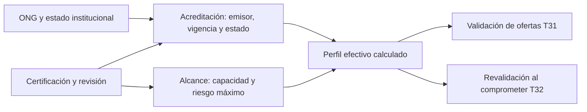
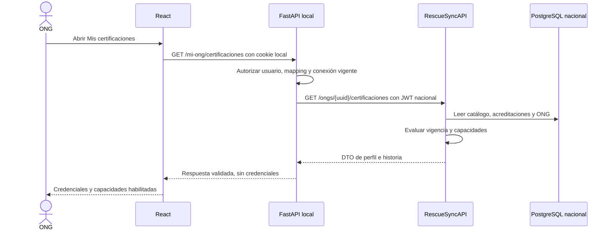
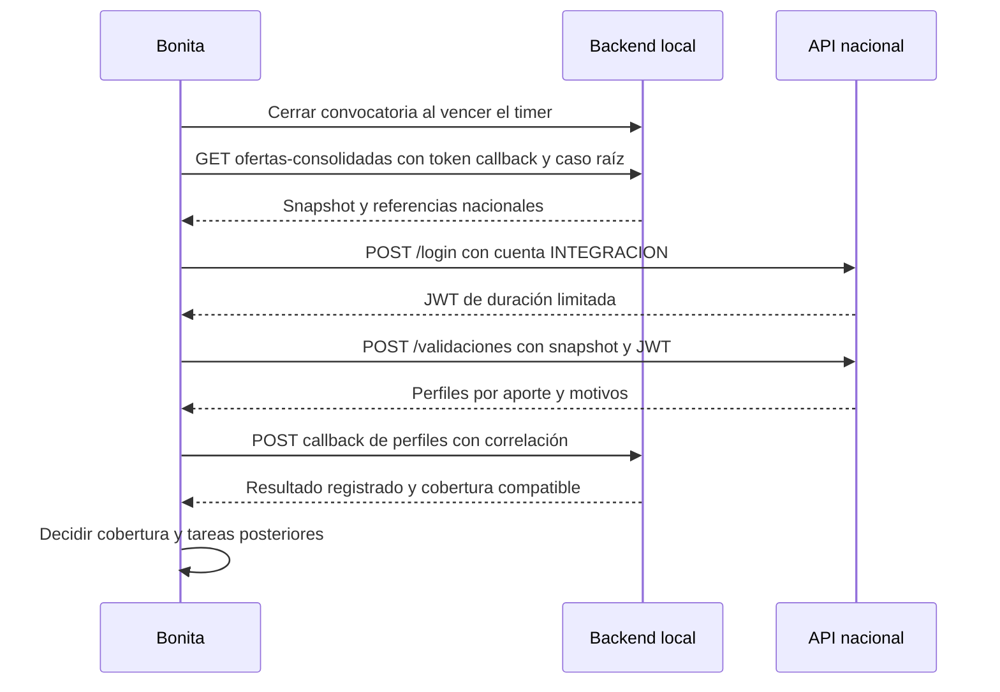

# Implementación de T28: certificaciones e integración con RescueSync y Bonita

Propuesta elaborada el **13/10/2026** para el
[issue #7 — T28](https://github.com/neftalito/RescueSyncAPI/issues/7).
Este documento describe la implementación pendiente; no acredita que los
endpoints, las pantallas o los conectores propuestos ya estén implementados.

**Actualización 14/10/2026:** se implementó el corte de consulta y administración
T28 en las ramas `feature/t28-certificaciones` y
`feature/t28-consulta-certificaciones`. Su contrato final y operación están en
[certificaciones.md](./certificaciones.md); los servicios administrativos dejan
el commit al CLI. Este documento conserva el diseño y el relevamiento inicial.
Los cambios T31/T34/T36 de validación automática/BPM siguen pendientes.

La solución reutilizaría el esquema nacional, agregaría la consulta protegida
del catálogo y un mecanismo administrativo para otorgar, renovar y revocar
acreditaciones. En `RescueSync/` ampliaría el adaptador nacional y la interfaz
para que una ONG consulte sus certificaciones. Para utilizarlas automáticamente
al evaluar ofertas, además habría que completar los contratos locales y
modificar el BPM de Bonita junto con T31/T34/T36.

## 1. Alcance y fuentes

El issue exige:

- `GET /api/v1/certificaciones` autenticado, con capacidades y niveles asociados.
- Carga administrativa de certificaciones y vigencias de ONGs, con seed de desarrollo.
- Pruebas de vigencia, vencimiento y entradas inválidas, sin autoacreditación.
- Contratos, documentación, pruebas y evidencia del check `quality`.
- PRs enlazados y horas efectivas informadas, distinguiendo implementación,
  integración y despliegue.

El grooming asigna **4 horas** a T28, semana sugerida 1. Esa estimación se
conserva como referencia original: no cubre automáticamente la interfaz local,
las migraciones de ofertas o los conectores BPM descritos aquí.

Se contrastaron:

- [Issue T28](https://github.com/neftalito/RescueSyncAPI/issues/7), abierto y sin
  comentarios al momento de la consulta.
- [Grooming Entrega 3](<./Grooming Entrega 3.xlsx>), fila T28 de la hoja
  `Backlog Entrega 3`.
- [Enunciado](<../../RescueSync/docs/Trabajo integrador 2026.pdf>), páginas 1–4:
  catálogo nacional, JWT, perfiles de competencia y orquestación por Bonita.
- [AGENTS nacional](../AGENTS.md), [AGENTS local](../../RescueSync/AGENTS.md),
  [plan de Entrega 3](./PLAN_IMPLEMENTACION_ENTREGA_3.md) y
  [modelo nacional](./modelo-base-datos-nacional.md).
- [Inventario local](../../RescueSync/docs/inventario-nacional.md),
  [proceso BPM](../../RescueSync/docs/bonita/proceso-bpm.md),
  [callbacks](../../RescueSync/docs/bonita/callbacks.md),
  [operación](../../RescueSync/docs/bonita/despliegue-y-operacion.md) y el contenido
  de [RescueSync-1.2.bar](../../RescueSync/docs/RescueSync-1.2.bar).

El código se relevó sobre `RescueSyncAPI` commit `50000b8` y `RescueSync` commit
`3e7b65f`. Los nombres de rutas, DTO y comandos nuevos de este documento son
**propuestas de implementación**. Los requisitos del issue y del enunciado se
separan de esas decisiones.

## 2. Qué ya existe y qué falta

| Componente | Estado verificado | Trabajo propuesto |
| --- | --- | --- |
| Modelos nacionales | `Capacidad`, `Certificacion`, `CertificacionCapacidad` y `OngCertificacion` existen en `app/db/models/catalogos.py`. | Reutilizarlos; no crear otro catálogo o una tabla JSON equivalente. |
| Integridad nacional | La revisión `20261004_0001` incluye vigencias, unicidad, autor administrativo, alcances obligatorios e historial inmutable. | Agregar servicios que respeten las restricciones y traduzcan conflictos. |
| Autenticación nacional | JWT y `CuentaActual` cargan cuenta, ONG y emisor vigentes; hay roles `ONG`, `ADMIN_NACIONAL`, `INTEGRACION`. | Reutilizar la dependencia y definir autorización de cada consulta/escritura. |
| Consulta nacional | Hay `/capacidades`, `/login`, `/me`, onboarding e inventario. | Agregar `/certificaciones` y consulta de acreditaciones por ONG. |
| Seed nacional | Crea capacidades, dos ONGs, cuentas e inventario. Las ONGs quedan pendientes; no carga certificaciones. | Ampliar el escenario de desarrollo conservando identidades y stock. |
| Adaptador local | `ClienteNacional` compartido, `ClienteNacionalDep`, errores seguros y DTO validados. | Añadir métodos y DTO para catálogo y acreditaciones. |
| Identidad local → nacional | `Organizacion.ong_nacional_id` y `ConexionNacional` con JWT cifrado, expiración y versión de sesión. | Reutilizar el mapping y la conexión, sin otro login o vínculo paralelo. |
| Frontend local | `MisRecursosPage`, `useInventarioNacional`, cliente HTTP y esquemas Zod. | Incorporar consulta de certificaciones y estado institucional. |
| Consolidado local | Existe `GET /emergencias/{id}/ofertas-consolidadas`; envía lotes, ofertas, versión e indicador de cobertura bruta. | Completar referencias nacionales y riesgos con T34. |
| Bonita 1.2 | Tiene timer, cierre y conector REST del consolidado. `Validar Oferta` existe sin conector; no aparecen llamadas a `/certificaciones`, `/validaciones` o `/compromisos` en el XML. | Incorporar validación nacional y callback de perfiles con T36. |

El proyecto fuente `.bos` no está versionado. Disponer del `.bar` permite
inspeccionar el proceso, pero la modificación debe realizarse en Bonita Studio
con el fuente obtenido del equipo o un modelo reconstruido y verificado.

## 3. Modelo de negocio que usaría

### 3.1. Catálogo y acreditación son entidades distintas

`Certificacion` define una certificación y su revisión. Sus alcances están en
`CertificacionCapacidad`: una certificación puede habilitar paramédicos hasta
riesgo `ALTA` y ambulancias hasta `MEDIA`, por ejemplo.

`OngCertificacion` registra que una ONG recibió esa revisión, quién la emitió,
el número de credencial, el administrador que verificó la carga, las fechas y
la eventual revocación. La vigencia pertenece a esta acreditación, no a la
definición del catálogo.

La habilitación institucional de `Ong.estado` es otra condición. Una ONG
`PENDIENTE` puede consultar el catálogo y sus credenciales, pero no adquiere
competencias operativas por registrarse o cargar recursos.



### 3.2. Vigencia y perfil efectivo

Usar un instante `ahora` UTC consciente de zona horaria, calculado una vez por
evaluación. El intervalo temporal existente es **`[vigente_desde, vigente_hasta)`**:

```python
vigente_desde <= ahora < vigente_hasta
```

Una acreditación aporta competencia únicamente cuando se cumplen todas estas
condiciones:

1. La ONG está `HABILITADA`.
2. La acreditación está `OTORGADA` y dentro de su intervalo de vigencia.
3. La revisión de certificación está activa.
4. La capacidad del alcance está activa.

El estado temporal presentado al usuario puede ser `FUTURA`, `VIGENTE`,
`VENCIDA` o `REVOCADA`, con prioridad para la revocación. Se calcula al consultar;
no agrega valores a `EstadoAcreditacion` ni requiere un cron para vencer filas.
Una credencial temporalmente vigente puede ser inefectiva si la ONG o el
catálogo no están habilitados.

Si varias acreditaciones habilitan la misma capacidad, tomar el mayor riesgo
entre las que efectivamente sirven. El orden debe ser explícito:

```python
ORDEN_RIESGO = {
    NivelRiesgo.BAJA: 0,
    NivelRiesgo.MEDIA: 1,
    NivelRiesgo.ALTA: 2,
    NivelRiesgo.CRITICA: 3,
}
```

No comparar strings ni usar una acreditación de ambulancias para habilitar
paramédicos. Conservar las referencias de las acreditaciones que justifican
cada capacidad. Un permiso máximo `ALTA` permite `BAJA`, `MEDIA` y `ALTA` para
esa capacidad, nunca `CRITICA`.

Las consultas deben devolver capacidades, niveles y motivos. Un booleano de
vigencia puede ayudar a la interfaz, pero no reemplaza el perfil de competencia
que necesitan T29/T31.

### 3.3. Versionado e historial

- Publicar una revisión requiere al menos un alcance y capacidades válidas.
- Una revisión otorgada conserva sus alcances; cambiar competencias crea otra
  revisión con otro UUID. No actualizar las acreditaciones antiguas para
  apuntarlas silenciosamente a la nueva.
- Renovar crea otra `OngCertificacion`, preservando la anterior.
- Revocar conserva la fila y registra administrador, fecha y motivo.
- No borrar historia ni cambiar fechas, emisor, autor o identidad de una
  acreditación otorgada para corregirla: revocar y registrar otra.
- El esquema exige unicidad de `(ong_id, emisor, numero_credencial)`.
  La renovación necesita una referencia oficial distinta. Si el emisor reutiliza
  el número, habrá que acordar una representación de la revisión de credencial
  y, si corresponde, una nueva migración; no inventar sufijos sin trazabilidad.

## 4. Contratos nacionales propuestos

### 4.1. `GET /api/v1/certificaciones`

Implementar una ruta síncrona con `Db`, `CuentaActual` y
`response_model=list[CertificacionResponse]`. Mantener el formato de lista que
ya utilizan `/capacidades` e inventario.

| Parámetro opcional | Semántica propuesta |
| --- | --- |
| `capacidadId` | Seleccionar revisiones que incluyan esa capacidad activa. UUID inválido: `422`; UUID válido sin coincidencias: `200 []`. |
| `nivelRiesgo` | Seleccionar revisiones con al menos un alcance activo que permita ese riesgo. Combinado con `capacidadId`, ambos deben cumplirse en el mismo alcance. |
| `incluirInactivas=false` | Mostrar sólo revisiones activas. `true` requiere `ADMIN_NACIONAL` y sirve para administración. |

Orden estable por `codigo`, `revision`, `id`; ordenar los alcances por código e
ID de capacidad. Devolver todas las revisiones activas que cumplan los filtros,
no sólo la última: una ONG puede seguir acreditada en una revisión anterior.
El filtro selecciona certificaciones; la respuesta conserva **todos sus
alcances** para no presentar una revisión como si su definición fuera parcial.

Ejemplo de respuesta, con UUID ilustrativos:

```json
[
  {
    "id": "00000000-0000-4000-8000-000000000101",
    "codigo": "RESPUESTA_SANITARIA",
    "revision": 1,
    "nombre": "Respuesta sanitaria en emergencias",
    "activa": true,
    "alcances": [
      {
        "capacidadId": "00000000-0000-4000-8000-000000000102",
        "codigo": "PARAMEDICOS",
        "nombre": "Personal paramédico",
        "tipo": "PERSONAL",
        "unidad": "personas",
        "admiteFracciones": false,
        "activa": true,
        "riesgoMaximo": "ALTA"
      }
    ]
  }
]
```

Una capacidad inactiva permanece visible en los alcances de una revisión
consultada, marcada como tal; no contribuye al perfil ni satisface filtros de
competencia. Retenerla explica el historial sin alterar la definición otorgada.

El catálogo no incluye ONGs, emisor de una credencial individual, vigencias
individuales ni datos de cuentas. Tampoco demuestra que la ONG consultante
posea una certificación de la lista.

### 4.2. `GET /api/v1/ongs/{ong_id}/certificaciones`

Esta ruta adicional es una propuesta para integrar la consulta en RescueSync.
El GET de catálogo por sí solo no permite mostrar las acreditaciones de una
ONG, ni verificar el escenario vigente/vencido de punta a punta.

Devolver un `CertificacionesOngResponse` con:

| Campo | Contenido |
| --- | --- |
| `ongId`, `estadoOng` | Identidad nacional y estado institucional vigente. |
| `evaluadoEn` | Instante UTC usado en toda la evaluación. |
| `acreditaciones` | ID, revisión de certificación, emisor, número, intervalo UTC, estado persistido, estado temporal calculado, alcances y motivos que impiden su uso. |
| `capacidadesHabilitadas` | Capacidad, unidad, riesgo máximo efectivo, niveles permitidos y IDs de acreditaciones que sustentan ese alcance. |
| `motivosInstitucionales` | Por ejemplo `ONG_PENDIENTE`; lista vacía cuando no hay impedimento institucional. |

Por defecto mostrar historial, incluidas futuras, vencidas y revocadas, para que
la ONG entienda su situación. La lista `capacidadesHabilitadas` siempre excluye
los alcances inefectivos. Una ONG sin credenciales devuelve `200` con listas
vacías; una ONG inexistente, `404`, después de autorizar el acceso.

Motivos propuestos: `ACREDITACION_FUTURA`, `ACREDITACION_VENCIDA`,
`ACREDITACION_REVOCADA`, `CERTIFICACION_INACTIVA`, `CAPACIDAD_INACTIVA`,
`ONG_PENDIENTE`, `ONG_SUSPENDIDA` y `ONG_BAJA`. Definirlos como enum del contrato
y acompañarlos de mensajes seguros en español.

Representar cada motivo como `{ "codigo": "...", "mensaje": "..." }`.
Para un alcance inactivo, incluir `capacidadId` en el motivo correspondiente;
la acreditación puede seguir habilitando otros alcances activos. No descartar
toda una credencial por una única capacidad inactiva.

La consulta es informativa. T31 carga el mismo perfil mediante servicios internos,
sin llamar por HTTP a su propia API. T32 lo reevalúa al comprometer.

### 4.3. Autorización

| Operación | ONG | Administración nacional | Integración |
| --- | --- | --- | --- |
| Catálogo activo | Permitida con cuenta/ONG activas, incluso ONG pendiente. | Permitida. | Permitida con emisor activo. |
| Catálogo incluyendo inactivos | `403`. | Permitida. | `403`. |
| Acreditaciones de una ONG | Sólo su `ong_id`; otra ONG: `403`. | Cualquier ONG. | Lectura para validación, con cuenta/emisor activos. |
| Publicar catálogo, otorgar, renovar, revocar o habilitar ONG | Denegada. | Permitida mediante comando autenticado. | Denegada. |

`obtener_cuenta` ya impide autenticación con cuenta inactiva (`401`), acceso de
ONG suspendida/de baja (`403`) y emisor inactivo (`403`). Mantener ese comportamiento:
una ONG suspendida se inspecciona con administración o integración, no relajando
la dependencia para su representante.

Autorizar antes de consultar una ONG ajena para evitar revelar existencia.
Agregar `autorizar_certificaciones` y la verificación administrativa pertinente;
no reutilizar el nombre `autorizar_inventario` para otro dominio.

En OpenAPI declarar Bearer, ejemplos, `summary`, `description` y errores seguros
`{"detail": "..."}`. Reutilizar el handler de `422` de `app/main.py`, que no
expone el input de Pydantic. Las respuestas de perfil llevarían
`Cache-Control: no-store`; no guardar una habilitación temporal como garantía.

## 5. Implementación en RescueSyncAPI

### 5.1. Archivos y responsabilidades

| Archivo | Cambio propuesto |
| --- | --- |
| `app/schemas/certificaciones.py` — nuevo | DTO de catálogo, alcances, acreditaciones, perfil y entradas del comando administrativo; aliases camelCase, `extra="forbid"`. |
| `app/services/certificaciones.py` — nuevo | Consultas, reglas de vigencia/riesgo, perfil efectivo y transacciones administrativas. |
| `app/api/routes/certificaciones.py` — nuevo | Los dos GET, autorización, traducción de errores y documentación HTTP. |
| `app/api/router.py` | Registrar el router con tag `certificaciones`. |
| `app/api/dependencies.py` | Autorización de lectura por ONG/rol. |
| `app/scripts/certificaciones.py` — nuevo | CLI administrativo, autenticación y validación de archivos JSON. |
| `app/scripts/seed.py` | Escenario demo de certificaciones, respetando sus protecciones actuales. |
| `tests/test_certificaciones.py` — nuevo | Contratos, perfiles, permisos y casos temporales. |
| `tests/test_certificaciones_admin.py` — nuevo | Carga, renovación, revocación, rollback y carreras administrativas relevantes. |
| `README.md` y documentación | Endpoints, comandos, ejemplo y vínculo a la guía local. |

Los modelos actuales no declaran relaciones ORM para recorrer el catálogo.
Usaría `select` y joins explícitos con las tablas existentes, devolviendo DTO
tipados. No hace falta añadir relaciones sólo para serializar estas consultas.
SQLAlchemy permite seleccionar entidades y columnas explícitamente;
véase su [guía de consultas](https://docs.sqlalchemy.org/en/20/orm/queryguide/columns.html).

La consulta del catálogo debe filtrar y cargar el conjunto de revisiones y
alcances sin una consulta por certificación. Para filtros, utilizar `EXISTS`
sobre los alcances que cumplen la condición y un join separado para obtener
todos los alcances seleccionados. Agrupar por UUID de revisión al construir la
respuesta; evitar que un join multiplique certificaciones.

No limitar un join N:M por número de filas y después agrupar: cortaría alcances.
Si el volumen exige paginación más adelante, paginar primero las revisiones.

Para perfiles, leer de forma conjunta las acreditaciones y sus alcances, evaluar
con el mismo `ahora` y agrupar por capacidad. Una función pura de evaluación con
hora explícita permite probar los límites exactos sin sleeps ni dependencia de
la hora del equipo. Reutilizarla en T29/T31/T32 cuando se implementen esos usos;
no introducir una tabla persistida de perfiles nacionales.

### 5.2. Carga administrativa completa

Elegiría un **CLI autenticado** para este corte, como prevé el plan. Así se
completa la carga sin añadir una consola administrativa web y un CRUD que el
issue no exige. Los servicios quedan disponibles para futuras rutas de
administración con idénticas reglas.

Comandos propuestos, todavía inexistentes:

```bash
python -m app.scripts.certificaciones --login admin@example.org publicar --archivo catalogo.json
python -m app.scripts.certificaciones --login admin@example.org otorgar --archivo acreditacion.json
python -m app.scripts.certificaciones --login admin@example.org revocar --archivo revocacion.json
python -m app.scripts.certificaciones --login admin@example.org habilitar-ong --archivo habilitacion.json
```

El comando pide contraseña mediante `getpass`, usa Argon2 y verifica una cuenta
existente `ADMIN_NACIONAL` activa. El login no es autorización suficiente: cada
servicio administrativo vuelve a comprobar la identidad vigente. La contraseña
no se pasa por argumentos, no se persiste y no se imprime. Para automatización,
definir entrada por secreto del entorno o archivo montado, nunca un valor
versionado. No reutilizar cuentas locales de administrador ni el callback de Bonita.

La cuenta administrativa nacional necesita aprovisionamiento previo: hoy el
seed no crea una. Documentar o completar un bootstrap separado y explícito,
ejecutable por el operador con acceso al entorno. Debe crear sólo una cuenta
faltante con hash Argon2 y secreto elegido por el operador, rechazar colisiones
y no elevar/reemplazar cuentas existentes. No abrir un endpoint público para
crear administradores. Las cuentas técnicas para Bonita se provisionan por
separado con su `SistemaOrigen`, como dependencia T25/T36.

Ejemplo de `catalogo.json`:

```json
{
  "codigo": "RESPUESTA_SANITARIA",
  "revision": 1,
  "nombre": "Respuesta sanitaria en emergencias",
  "alcances": [
    {
      "capacidadId": "00000000-0000-4000-8000-000000000102",
      "riesgoMaximo": "ALTA"
    }
  ]
}
```

Ejemplo de `acreditacion.json`:

```json
{
  "ongId": "00000000-0000-4000-8000-000000000103",
  "certificacionId": "00000000-0000-4000-8000-000000000101",
  "emisor": "Autoridad acreditadora de ejemplo",
  "numeroCredencial": "DEMO-2026-001",
  "vigenteDesde": "2026-10-01T00:00:00Z",
  "vigenteHasta": "2027-10-01T00:00:00Z"
}
```

Campos de revocación: `ongId`, `acreditacionId`, `motivo`; de habilitación:
`ongId`. El servidor obtiene autor, estado y timestamps. Rechazar entradas que
intenten fijar `registradaPorId`, `revocadaPorId`, `estado`, `habilitadaPorId`
o permisos.

Validar UUID, enum, textos no vacíos, longitudes del modelo, revisión positiva,
lista no vacía de alcances sin capacidad repetida y referencias existentes.
Las fechas deben ser conscientes de zona horaria y normalizarse a UTC, con
`vigenteHasta > vigenteDesde`. `AwareDatetime` ofrece la validación de zona en
[Pydantic](https://docs.pydantic.dev/latest/api/standard_library_types/#datetimes).
Un intervalo válido que ya venció puede cargarse como historia verificada,
pero nunca habilita; una fecha de inicio futura tampoco habilita antes de tiempo.

Comportamiento de los servicios:

- **Publicar:** comprobar capacidades activas; crear revisión y alcances en una
  transacción; marcar activa antes del commit. Una revisión ya existente con
  contenido equivalente devuelve su referencia; contenido diferente es conflicto,
  se propone una nueva revisión. No editar competencias ya publicadas desde este CLI.
- **Otorgar:** verificar ONG, revisión activa y alcances válidos; insertar
  `OTORGADA`, con el UUID del administrador autenticado. No habilitar la ONG
  implícitamente. Permitir carga histórica/futura sin confundirla con competencia actual.
- **Renovar:** usar `otorgar` con otra credencial verificada. La anterior mantiene
  su intervalo e historia; revocarla sólo si la política de emisión lo exige.
- **Revocar:** comprobar pertenencia a la ONG, bloquear y actualizar una vez con
  motivo, autor y hora UTC. Si ya está revocada con el mismo motivo, devolver la
  referencia sin ejecutar otro UPDATE; no reemplazar autor/fecha. Motivo distinto:
  conflicto. El trigger actual prohíbe actualizar una fila ya revocada.
- **Habilitar ONG:** después de verificación institucional, actualizar a
  `HABILITADA`, `habilitada_en`, `habilitada_por_id` y `actualizado_en`.
  Una ONG ya habilitada no se reescribe. Suspensión/baja requieren una operación
  administrativa explícita; no reactivarlas incidentalmente con este comando.

Para reintentos de `otorgar`, aprovechar la clave única de credencial: mismo
contenido canónico devuelve la existente, contenido distinto es conflicto.
Si dos procesos compiten, capturar la violación de esa restricción específica,
hacer rollback y consultar el registro confirmado antes de comparar. No usar
`ON CONFLICT DO UPDATE` sobre una acreditación inmutable.

Estos comandos no usan `OperacionIdempotente`: su enum actual sólo contempla
compromiso, liberación y cierre. Una futura API administrativa invocada por
conectores necesitaría definir su idempotencia y migrar ese contrato si corresponde.

El CLI informa ID y resultado seguro, y termina con código distinto de cero ante
fallos. Las excepciones de negocio son independientes de HTTP; no emitir SQL ni
trazas de `IntegrityError` al usuario. Traducir sólo restricciones conocidas;
los fallos inesperados se reportan como error interno seguro, no como un
duplicado ficticio.

### 5.3. Transacciones, concurrencia y migraciones

Las consultas no escriben ni reservan inventario. Las cargas administrativas
son atómicas: catálogo con alcances y publicación, o una acreditación completa.
Confirmar éxito después de `commit`, con rollback ante errores, incluidos los
triggers diferidos que pueden fallar recién al confirmar.

Mantener un solo dueño de la transacción. Los servicios pueden seguir el patrón
actual de `commit`/`rollback`; el CLI no debe abrir otro `Session.begin()` sobre
una sesión cuya autenticación ya inició una transacción por autobegin.

Orden propuesto para escrituras: cuenta administrativa vigente, ONG cuando
corresponde, definiciones de catálogo/capacidades en orden estable, acreditación.
Otorgar y revocar toman lock exclusivo de ONG y certificación antes de modificar
la acreditación, coherente con el trigger existente. Precargar locks en el
servicio y recargar valores después de esperas; no confiar en objetos ya cargados
en el identity map.

Hay un detalle a coordinar con T32: `nacional_proteger_alcance` toma primero
`FOR SHARE` de capacidad y después `FOR UPDATE` de certificación. Al publicar,
tomar primero las capacidades ordenadas y después la revisión. Al otorgar,
tomar primero la ONG, después las capacidades ordenadas y después la revisión.
Los futuros lectores transaccionales deben adoptar el mismo orden para estas
definiciones. No afirmar que los triggers existentes garantizan por sí solos
todo el protocolo entre servicios.

Los locks de PostgreSQL son el mecanismo compartido entre procesos; mantener
transacciones cortas y no hacer llamadas externas mientras se retienen. Referencia:
[locking en PostgreSQL 16](https://www.postgresql.org/docs/16/explicit-locking.html).

T32 tomará los locks de permisos, ONG y catálogo necesarios para revalidar el
perfil; evaluará la hora real después de adquirirlos. Una certificación que vence
entre T31 y T32, o durante una espera, deja de servir para el compromiso.
Consultar certificaciones no promete disponibilidad ni reserva stock.

Para el núcleo de T28 **no se necesita una migración nueva**: las tablas,
índices y restricciones ya están creados. Tampoco editar la revisión aplicada
`20261004_0001`. Si aparece una necesidad nueva de esquema, crear otra revisión
manual con upgrade/downgrade y pruebas; separar esa decisión del catálogo HTTP.

### 5.4. Seed de desarrollo

Ampliar el seed preservando los dos UUID de ONG coordinados con RescueSync.
Agregar una cuenta administrativa demo aislada, revisiones, alcances y escenarios
de credenciales vigentes, vencidas, futuras y revocadas. Habilitar únicamente
las ONGs demo que el escenario declare habilitadas y crear además un caso pendiente.

El script existente permite `development` y `test`: conservar esa protección;
las fixtures pueden usar el escenario en pruebas y producción debe rechazarlo
antes de escribir. La carga productiva se hace con el mecanismo administrativo.

Definir UUID demo estables con `uuid5` y fechas relativas a una hora del escenario
recibida como parámetro. Crear sólo registros faltantes; no correr fechas hacia
adelante al repetir el seed, no revivir revocadas, no cambiar contraseñas ni
sobrescribir stock o compromisos. Si el escenario envejeció, documentar su fecha
o preparar nuevos registros en un entorno descartable.

Las colisiones de identidad o cambios de contenido deben producir un error
seguro, no apropiarse de una cuenta o una credencial existente. Una repetición
completa debe conservar los mismos IDs, fechas y cantidades. No incluir datos
reales ni cuentas técnicas productivas en el seed.

## 6. Integración en RescueSync: backend y frontend

### 6.1. Adaptador local

La consulta de la ONG recorrerá:



En `backend/app/integrations/nacional/cliente.py` añadir métodos tipados
`certificaciones(token, filtros)` y `certificaciones_ong(token, ong_id)` usando
el HTTPX ya compartido y `TypeAdapter`. Para filtros, ampliar `_request` con
parámetros de consulta tipados; no construir URLs con strings sin validar.

Crear `backend/app/schemas/certificaciones.py` con DTO equivalentes al contrato
nacional, sin importar módulos Python del otro repositorio. Ampliar el servicio
local para obtener el JWT mediante `credencial(session, usuario)` y el UUID
desde `Organizacion.ong_nacional_id`.

Rutas locales propuestas:

| Método y ruta local | Traducción nacional | Permisos |
| --- | --- | --- |
| `GET /api/v1/mi-ong/catalogo-certificaciones` | `GET /api/v1/certificaciones` | `UsuarioInventario` y conexión nacional vigente. |
| `GET /api/v1/mi-ong/certificaciones` | `GET /api/v1/ongs/{ong_nacional_id}/certificaciones` | Misma dependencia, ONG obtenida del usuario. |

No aceptar un `ongId` libre del navegador en estas rutas. Reutilizar
`/mi-ong/conexion`, su login nacional, cifrado, expiración y desconexión. Una ONG
sin mapping recibe el conflicto de vinculación correspondiente; sin conexión,
`401` y opción de conectar. Cuenta nacional ajena sigue rechazada.

La cookie autentica la sesión local; el JWT autentica al backend frente al
Sistema Nacional. El navegador no recibe el JWT. Los GET no necesitan CSRF;
conectar/desconectar conserva los controles de escritura existentes.

El adaptador debe seguir traduciendo timeout a `504`, caída a `503`, DTO inválido
a `502` y autenticación/autorización nacional a `401`/`403`. Actualizar los
mensajes de `ClienteNacional`: los actuales `404` y `422` mencionan recursos e
inventario, por lo que no describen correctamente certificaciones.
Un catálogo vacío es `200`, no un error de conexión.

Ante `401`/`403` nacional conservar el comportamiento de desconexión del
adaptador y limpiar la caché del perfil. No reautenticar automáticamente con una
contraseña persistida. Mantener `no-store` en respuestas personales y no
persistir el catálogo o el perfil como nueva fuente nacional de verdad.

La consulta T28 no requiere otra migración local: las referencias y la conexión
ya existen. Sí requiere pruebas RESPX del cliente y de las rutas con permisos,
UUID correcto, headers, errores y contrato externo inválido.

### 6.2. Interfaz

Añadir **Mis certificaciones** dentro de la experiencia de la ONG. Una primera
implementación puede ser una sección en `MisRecursosPage` que reutilice el panel
de conexión; separar componentes para no seguir agrandando esa página.

Archivos propuestos: `frontend/src/schemas/certificaciones.ts`,
`api/certificaciones.ts`, `hooks/useCertificacionesNacionales.ts` y
`components/CertificacionesOng.tsx`, con sus pruebas. Usar Zod para UUID, estados,
riesgos, fechas y listas; TanStack Query para estado remoto, sin copiarlo a un
contexto global.

Mostrar:

- Estado institucional y explicación de que registrarse no concede competencia.
- Credencial, emisor, revisión y fechas de inicio/fin, con etiqueta vigente,
  futura, vencida o revocada.
- Cada capacidad y su riesgo máximo efectivo; motivos de inhabilitación legibles.
- Catálogo como referencia separada de las credenciales que la ONG posee.
- `evaluadoEn` y acción de actualizar; no presentar el perfil como garantía de
  adjudicación o stock.

Contemplar carga, historial vacío, error, conexión vencida y reintento manual.
Usar timezone local sólo para presentación; la API trabaja en UTC. Al alcanzar
un vencimiento mostrado, invalidar/refrescar la consulta o indicar que requiere
actualización. El estado servidor decide; no usar la caché del navegador para
autorizar ofertas o adjudicaciones.

Incluir usuario y ONG vinculada en las claves de consulta. Limpiar datos al
desconectar, cerrar sesión, cambiar mapping o perder permisos. Los enlaces de
registro/conexión reutilizan el flujo existente; no incluir formularios para
emitir, renovar, revocar o habilitarse como ONG.

Un administrador local no se convierte en `ADMIN_NACIONAL`. Para una futura
consola de carga habría que diseñar su autenticación nacional administrativa;
el CLI permite completar T28 sin inventar esa equivalencia de roles.

## 7. Cómo llegan las certificaciones a la validación de ofertas

La pantalla anterior integra T28 en ambos repositorios. La evaluación automática
requiere además T29/T30/T31/T34/T36. Diseñar ese recorrido ahora evita entregar
un GET que después no pueda usarse, pero esos cambios deben conservar su
trazabilidad y pruebas por tarea.

### 7.1. Datos locales que faltan

El consolidado actual usa `tipo_necesidad`, descripciones, `tipo=MIXTO`, cantidades
y unidades, pero no vincula sus ítems a recursos nacionales. Antes de validar
competencias de forma fiable:

1. Agregar capacidad nacional y riesgo requerido a `Lote`, y guardar también
   esos campos en el snapshot `ConvocatoriaLote` al publicar. El consolidado
   debe usar lo publicado para esa ronda, no el lote que luego se reformuló.
2. Desglosar cada `OfertaItem` en aportes nacionales con recurso UUID, ONG dueña
   y cantidad `Numeric(14,3)`. Una tabla local propuesta `oferta_item_aporte`
   permite varios recursos por ítem sin romper su unicidad actual por lote/version.
3. Vincular cada aporte al participante que lo ofrece y a la versión de oferta;
   conservar también el mapping nacional usado al presentar. Cambiar el vínculo
   institucional después no debe reinterpretar una oferta histórica.
4. Validar pertenencia, unidad, capacidad y cantidades. Las referencias UUID
   nacionales son externas: no declarar FK a la base nacional. Las relaciones
   entre tablas locales sí llevan FK, índices, checks y unicidad.
5. Completar la aceptación de participantes para consorcios. Su tabla existe,
   pero no basta para atribuir recursos o prestar la certificación de la líder
   a los miembros.

Crear migraciones locales nuevas con upgrade/downgrade. Para datos existentes,
las referencias nuevas pueden empezar nulas; marcar ofertas sin mapping como
pendientes de asociación y excluirlas de adjudicación nacional hasta completarlo.
No borrar ofertas ni mapear por nombre/descripción. Cerrar la edición según
las reglas de convocatoria vigentes.

Actualizar formularios de lotes y ofertas, schemas, servicios y las pruebas
correspondientes de T34. Para que el coordinador elija capacidades, preparar
un GET local protegido de catálogo con una **cuenta técnica de lectura** del
backend, separada del JWT de una ONG. Requiere aprovisionamiento, caché de token
en el servidor y reautenticación acotada; no compartir la contraseña técnica
con el frontend ni prometer que el login de inventario cubre ese rol.

### 7.2. Ampliación compatible del consolidado

Conservar `idEmergencia`, `convocatoriaId`, `numero`, `lotesCubiertos`, `lotes`,
`ofertas`, IDs locales, `version`, `loteId` y unidades existentes. Añadir:

- Correlación: `sistemaOrigen`, `caseId`, gravedad y mappings de ONGs nacionales.
- Lotes: capacidad requerida y riesgo del snapshot publicado.
- Aportes: participante, `ongNacionalId`, `recursoNacionalId` y cantidad exacta.

`backend/app/schemas/bonita.py` actualmente serializa `Cantidad` como número
mediante `PlainSerializer(float, ...)`. No cambiar ese campo silenciosamente:
conservar lo que requiere 1.2 y enviar las **cantidades nacionales nuevas como
strings decimales**, alineadas con el contrato de T31. Bonita debe usar
`BigDecimal` para esas cantidades y validar el DTO, no convertirlas a `double`.

T31 recibirá el consolidado al cierre y devolverá perfiles por
oferta/versión/participante/lote/aporte, con capacidades, riesgos, motivos,
disponibilidad consultada y `evaluadoEn`. Los lotes de apoyo también deben ser
compatibles: `APOYO` no habilita tareas críticas sin competencia suficiente.

La validación es transitoria en la API nacional: no guardar ofertas ni cuerpos
de validación. T32 recarga perfil y disponibilidad antes de comprometer, aunque
la evaluación previa haya permitido participar.

## 8. Cambios necesarios en Bonita

**T28 para consulta de catálogo y pantalla no requiere cambiar el BPM. Usar las
certificaciones en la evaluación automática sí requiere modificar el proceso.**
El `.bar` 1.2 consulta el consolidado y decide con `lotesCubiertos`, que representa
cantidad bruta. La tarea `Validar Oferta` no tiene implementación nacional.

Recorrido propuesto para T36:



No hace falta que Bonita descargue `/certificaciones` para recalcular reglas en
Groovy: la autoridad es T31 dentro de la API nacional. El catálogo sirve a los
clientes de consulta y a la configuración; la validación nacional utiliza
directamente sus propios servicios y datos.

Cambios concretos:

1. Obtener el `.bos` o reconstruir el proceso en Studio a partir del artefacto
   inspeccionado, validando tareas, contratos y transiciones.
2. Crear una versión nueva del pool, por ejemplo `1.3` si sigue disponible;
   incorporar el conector nacional en `Validar Oferta` antes de la decisión
   de cobertura y selección.
3. Aprovisionar una cuenta `INTEGRACION` vinculada a su `SistemaOrigen` y
   parametrizar login, URL y timeouts. No usar el token de callback como JWT.
4. Obtener JWT por login, mantenerlo por su duración y permitir como máximo una
   reautenticación ante `401`. No meter tokens en logs, formularios o parámetros
   versionados del `.bar`.
5. Validar respuesta nacional y llamar a un callback local nuevo, propuesto
   `POST /api/v1/emergencias/{id}/perfiles-competencia`.
6. El callback exige `validar_callback_bonita`, caso raíz vinculado, convocatoria
   vigente cerrada y referencias/versiones que pertenezcan al snapshot. Una
   ronda anterior no puede actualizar la ronda actual.
7. Persistir perfiles **en la base local**, con referencias a oferta versión,
   participante y lote, fecha de evaluación y estado de sincronización. Propuesta:
   tabla `perfil_competencia` con unicidad por esas referencias y aporte, y un
   registro de evaluación correlacionado para idempotencia/reconciliación.
8. Un reintento del callback con la misma clave de evaluación y contenido
   devuelve el resultado anterior; misma clave con otro contenido es `409`.
   Una reevaluación necesita otra identidad y reemplaza el resultado vigente
   de forma controlada, conservando historia. No confundir transporte repetido
   con una evaluación nueva cuya hora/disponibilidad pudo cambiar.
9. Alimentar la compuerta con **cobertura compatible**, conservando la cobertura
   bruta para diagnóstico. No sumar el mismo recurso que figura en dos ofertas
   alternativas ni dar por cubierta una combinación que disputa el mismo stock.
10. Conservar los caminos `REABRIR`, `REFORMULAR` y `CONTINUAR_PARCIAL`. Reabrir
    genera otra convocatoria y otra evaluación, no reutiliza perfiles viejos.

Ante caída, timeout o contrato inválido, el caso debe quedar pendiente de
validación/error técnico recuperable; no convertir el fallo en perfil habilitado
ni avanzar a selección como si se hubiera validado. Una credencial vencida es
un resultado de negocio con motivos, no un fallo técnico del conector.

El callback necesita migración local, DTO, servicios, ruta, pruebas y consulta
para que municipio/coordinador vean los perfiles. Mostrar `PRINCIPAL`, `APOYO`
y `SIN_HABILITACION` por aporte; la selección y compromiso efectivos se completan
en T37 junto con T32, no se dan por implementados por este callback.

El PR local del cambio BPM debe incluir un único `.bar` nuevo, actualizado
`BONITA_PROCESS_VERSION`, parámetros de `deploy.py`, contratos, docs y
`backend/tests/integrations/bonita/test_bar_versionado.py`. Probar también que
un caso 1.2 existente conserva su comportamiento: las versiones nuevas se
instalan al lado de las anteriores, no se borran casos para cambiar parámetros.

## 9. Configuración entre sistemas

Conservar `NACIONAL_BASE_URL=http://host.docker.internal:8001/api/v1` para el
adaptador local y su `NACIONAL_TIMEOUT_SECONDS`. Este cliente ya incluye
`/api/v1` en la URL base.

Bonita usa otra convención propuesta: `BONITA_NATIONAL_API_BASE_URL` representa
la raíz `http://host.docker.internal:8001`; el conector añade `/api/v1/login` o
`/api/v1/validaciones`. Documentar esa diferencia para no duplicar prefijos.

Actualmente `.env.example`, Compose y `deploy.py` local conservan
`http://national-api:8000` como valor reservado para Bonita. No resuelve por
defecto entre los dos stacks independientes. Cambiar ese default y agregar
`host.docker.internal:host-gateway` al servicio **Bonita**, como ya hace el
backend local. El contenedor `bonita-deploy` inyecta la URL en el Runtime;
quien debe poder alcanzarla es el conector ejecutado por Bonita.

Proponer secretos como `BONITA_NATIONAL_LOGIN` y
`BONITA_NATIONAL_PASSWORD`, con parámetros BPM equivalentes, inyectados sólo
al instalar. Si el backend local necesita catálogo para coordinadores, usar
sus propias credenciales técnicas configuradas como secretos, separadas de
la conexión personal de ONG. En cloud usar HTTPS y URLs alcanzables desde cada
consumidor, sin publicar ni compartir PostgreSQL.

Las nuevas rutas nacionales siguen protegidas: no resolver el acceso del
frontend abriendo CORS ni exponiendo el catálogo sin JWT. El navegador consulta
su backend local. Mantener los puertos nacionales 8001/5433 y locales
8000/5432/5173/8080/8025.

## 10. Pruebas y criterios verificables

### 10.1. API nacional

| Grupo | Casos y resultado esperado |
| --- | --- |
| Autenticación | Sin JWT, expirado, firma/issuer/audience inválidos y cuenta inactiva: `401`; ONG suspendida/baja o emisor inactivo: `403`. |
| Catálogo | Varias capacidades con riesgos distintos, varias revisiones activas, orden estable, lista vacía, filtros sobre el mismo alcance y respuesta con alcances completos. |
| Permisos | ONG ve sólo sus acreditaciones; otra ONG recibe `403`; administración/integración leen según matriz; inactivos sólo administración. |
| Fechas | Justo en inicio: vigente; justo en fin: vencida; futura/vencida/revocada excluidas del perfil; offsets equivalentes producen misma evaluación UTC. |
| Perfil | Riesgo máximo por capacidad, sin mezclar capacidades; vigente de riesgo bajo más vencida de riesgo alto no eleva permisos; ONG pendiente y catálogo/capacidad inactivos producen motivos. |
| Entradas | UUID/enum/revisión inválidos, textos vacíos, fechas sin zona o invertidas, alcances vacíos/repetidos, referencia inexistente y campos de autor/rol rechazados. |
| Administración | Credencial ONG o integración no carga; autor real guardado; catálogo y alcances atómicos; renovación agrega otra fila; revocación conserva historia. |
| Reintentos | Misma credencial/contenido reutiliza ID; contenido diferente es conflicto; revocar dos veces conserva primer autor/fecha; colisión concurrente no duplica. |
| Concurrencia | Publicación/otorgamiento y renovación/revocación con conexiones independientes; invariantes preservadas y protocolo sin locks invertidos. Revalidación de T32 se cubre al implementar T32. |
| Seed | Repetición sin cambios de IDs/fechas/stock/passwords, colisiones seguras y ejecución en producción rechazada sin escrituras. |
| OpenAPI | Rutas, DTO, enum, fechas, aliases, Bearer y respuestas documentados. |

Reutilizar `engine_migrado`/`session` de `tests/conftest.py`, que aplican Alembic
en schemas temporales de PostgreSQL real. Las pruebas de concurrencia requieren
datos confirmados y conexiones separadas, no la misma sesión con savepoints.
Reutilizar las pruebas existentes de integridad; agregar las de comportamiento
HTTP/servicio que faltan, sin duplicar cada trigger como un test de implementación.

### 10.2. Backend y frontend locales

- RESPX: JWT en cabecera nacional, mapping correcto, validación DTO, timeout,
  caída, `401`/`403`, vacío y ausencia de credenciales en respuestas.
- RBAC local: representante consulta sólo su ONG; usuario de otro rol recibe
  denegación; vínculo ausente y conexión vencida llevan al flujo correcto.
- Vitest/Testing Library/MSW: credencial vigente y vencida, riesgo por capacidad,
  estado pendiente, carga/vacío/error, reconexión y limpieza de caché al cambiar
  usuario/ONG. Sin formulario de autoacreditación.
- T34: cantidades exactas, snapshot publicado, consorcios y conservación de
  referencias nacionales por versión; datos antiguos pendientes sin borrado.

### 10.3. Bonita y E2E

T36 añade pruebas del `.bar`, contratos y callback; dobles HTTP para fallos
nacionales y callbacks repetidos/ajenos/antiguos. La suite habitual no depende
de un Runtime o cloud real.

E2E controlada completa:

1. Seed nacional y local coordinado, administrador habilita una ONG y verifica
   acreditaciones; el representante conecta su cuenta y consulta la pantalla.
2. Municipio registra emergencia; coordinador publica lotes con capacidad/riesgo.
3. ONGs presentan aportes con referencias nacionales; Bonita vence el timer,
   cierra y obtiene el consolidado.
4. Bonita llama a T31 y persiste perfiles por callback. Credencial vencida
   aparece con motivo y no cubre competencia; riesgo suficiente sí contribuye.
5. Reabrir convocatoria no reutiliza el perfil anterior; caída nacional conserva
   estado recuperable sin permitir selección no evaluada.
6. Con T32/T37 integrados, vencer o revocar una acreditación después de validar
   impide comprometer con ese permiso. No hay reserva por consultar catálogo.

Pasos 2–6 verifican las tareas dependientes; no etiquetarlos como una E2E T28
ejecutada si aún faltan servicios o conectores. Para el corte T28 verificar al
menos administración → catálogo/acreditaciones → adaptador → pantalla.

### 10.4. Comandos de calidad al implementar

En `RescueSyncAPI/`:

```bash
docker compose config --quiet
docker compose build api migrate
docker compose run --rm api alembic upgrade head
docker compose run --rm api alembic check
docker compose run --rm api ruff check .
docker compose run --rm api ruff format --check .
docker compose run --rm -e APP_ENV=test api pytest --cov=app --cov-report=term-missing
```

En `RescueSync/`, para las capas modificadas:

```bash
docker compose run --rm backend ruff check .
docker compose run --rm backend ruff format --check .
docker compose run --rm backend pytest --cov=app --cov-report=term-missing
docker compose run --rm frontend npm run lint
docker compose run --rm frontend npm run typecheck
docker compose run --rm frontend npm test
docker compose run --rm frontend npm run build
```

Cuando haya cambios de esquema, aplicar y probar upgrade/downgrade/upgrade en
bases descartables. Para el BPM modificado añadir la prueba de artefacto y la
E2E con Runtime aislado según la guía local. Estos son controles futuros de la
implementación; preparar este Markdown no ejecuta ni acredita esos resultados.

## 11. Orden de trabajo y PRs

| Paso | Entregable | Repositorio / trazabilidad |
| --- | --- | --- |
| 1 | Acordar DTO de catálogo/acreditaciones, permisos, vigencia y comando administrativo. | T28; consumidores T29/T31. |
| 2 | Consultas y perfil interno, GET protegido, carga administrativa, bootstrap seguro, seed y tests. | PR en `RescueSyncAPI`, rama `feature/t28-certificaciones`. |
| 3 | Adaptador, GET locales, schemas Zod y pantalla de consulta de ONG. | PR en `RescueSync`, rama `feature/t28-consulta-certificaciones`, enlazado a #7 nacional. |
| 4 | ONGs habilitadas y disponibilidad global; servicio nacional de validación. | T29/T30/T31, PRs por tarea. |
| 5 | Snapshot de lotes y aportes con mappings; formularios y consolidado ampliado. | T34 en `RescueSync`; coordinar con inventario T27. Puede prepararse en paralelo con el paso 4 después del acuerdo de contratos. |
| 6 | Conector nacional, callback, persistencia local de perfiles y compuerta compatible. | T36 en `RescueSync`, nueva versión BPM; T35 verifica el conector de consolidado existente. |
| 7 | Compromiso/liberación y revalidación final de permisos, selección y seguimiento. | T32/T33 nacionales y T37 local/BPM. |
| 8 | E2E distribuida y evidencias de ambos PRs y BPM. | T41; documentación consolidada T40 y horas informadas T42. |

Los pasos 2 y 3 entregan T28 integrado para consulta. Los siguientes completan
su uso automático dentro del proceso, sin adjudicar todo ese trabajo a las
4 horas originales. T31 necesita el contrato del consolidado T34 antes de su
integración, aunque ambos equipos puedan avanzar con fixtures compartidas.

Cada PR parte de `develop` actualizado en su repositorio; revisar migraciones y
contratos cruzados y exigir `quality` exitoso en ambos. Integrar primero el
contrato nacional compatible y después el consumidor local. Instalar el BPM nuevo
cuando sus endpoints y parámetros estén disponibles; probar con casos nuevos
y conservar los anteriores en su versión.

Actualizar documentación nacional, índice local, guía de inventario/consulta,
callbacks y operación BPM según el corte implementado. En el issue enlazar los
PRs de ambos repositorios y distinguir: implementación local, checks en GitHub,
integración y despliegue real. Registrar sólo horas efectivas informadas; no
modificar ni versionar automáticamente el Excel.

## 12. Definición de terminado

T28 quedaría listo cuando el catálogo protegido exponga alcances y niveles,
la administración pueda otorgar, renovar y revocar sin autoacreditación,
el vencimiento se evalúe correctamente por fecha,
el seed sea reproducible y exclusivo de desarrollo/pruebas, y los contratos y
casos de prueba pasen `quality`. Para el alcance integrado de consulta aquí
propuesto, también debe funcionar la pantalla a través del adaptador local,
con permisos y manejo de fallos comprobados en su PR.

El uso automático de esos datos queda completo cuando T31 evalúe el snapshot
vigente, Bonita invoque esa validación y los perfiles lleguen a RescueSync con
correlación, historial y cobertura compatible. El compromiso de T32 debe
revalidar acreditaciones y stock en su transacción. La documentación de diseño
o un GET aislado no acredita ese recorrido distribuido.
