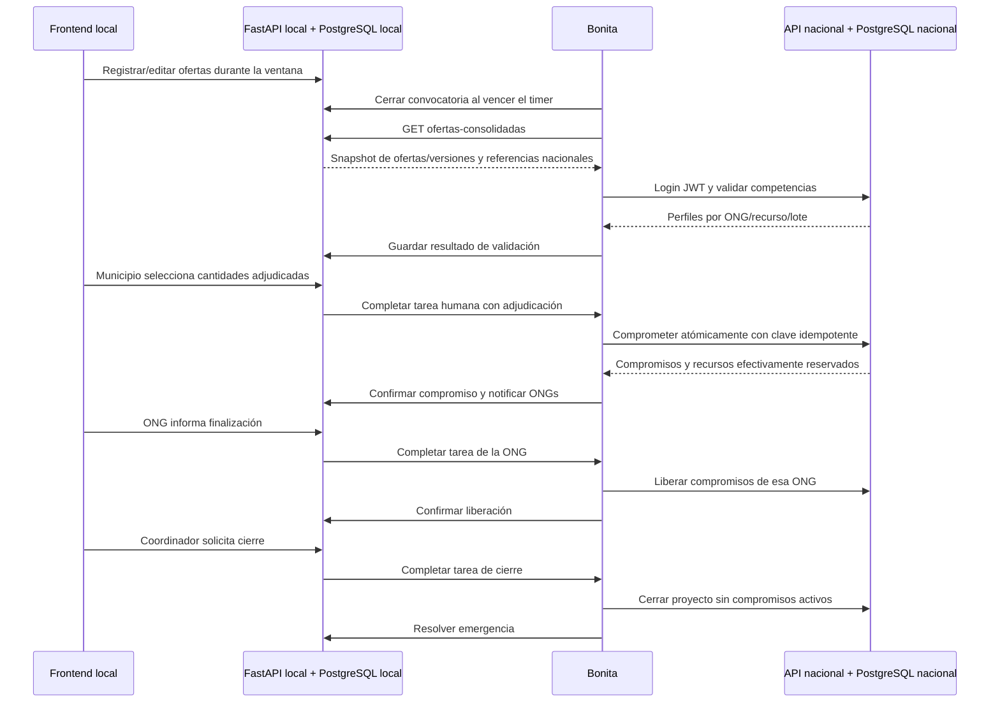

# Plan de implementación — Entrega 3 de RescueSync

> Actualización 20/10/2026: [perfiles informativos](./perfiles-competencia.md) reemplaza las
> reglas de certificación, habilitación previa y clasificación por riesgo de este
> documento. Las referencias a esas reglas describen el comportamiento anterior.


## Objetivo, fuentes y estado inicial

Entregar en la semana del **22/10/2026** una API nacional REST con JWT,
PostgreSQL, Docker y Swagger, desplegada en cloud e integrada con Bonita para
validar capacidades, comprometer recursos adjudicados y liberarlos al finalizar.
El grooming contiene **21 tareas, T22–T42, por 106 horas estimadas**; son horas de
trabajo, no duración calendario ni horas efectivamente realizadas.

Fuentes contrastadas el 01/10/2026:

- [Grooming Entrega 3](<./Grooming Entrega 3.xlsx>) y
  [enunciado](<../../RescueSync/docs/Trabajo integrador 2026.pdf>), páginas 1–4.
- [Reglas locales](../../RescueSync/AGENTS.md),
  [índice de documentación](../../RescueSync/docs/README.md),
  [flujo implementado](../../RescueSync/docs/flujo-actual.md),
  [autenticación local](../../RescueSync/docs/autenticacion-local.md) y
  [modelo local](../../RescueSync/docs/modelo-base-datos-rescuesync.md).
- [Proceso BPM](../../RescueSync/docs/bonita/proceso-bpm.md),
  [callbacks](../../RescueSync/docs/bonita/callbacks.md),
  [operación](../../RescueSync/docs/bonita/despliegue-y-operacion.md),
  [E2E](../../RescueSync/docs/bonita/pruebas-e2e.md), `.bar` 1.2 y código vigente.
- [Migraciones](../../RescueSync/docs/desarrollo/migraciones.md),
  [calidad](../../RescueSync/docs/desarrollo/calidad-y-pruebas.md) y
  [despliegue](../../RescueSync/docs/despliegue.md).

El código y el `.bar` resuelven diferencias entre documentos descriptivos. Por
ejemplo, `base-de-datos.md` aún anuncia revisiones hasta 0006, pero el esquema
ejecutable ya incluye 0007; `flujo-actual.md` y el servicio de callbacks aclaran
que confirmar el horario no duplica la notificación creada al publicar.

| Componente | Estado comprobado | Trabajo pendiente |
| --- | --- | --- |
| RescueSyncAPI | Base local en `feature/setup-api-cloud`: FastAPI, health, configuración, SQLAlchemy, Alembic sin revisiones de negocio, Docker/Compose y CI preparado; 15 tests locales aprobados. | Modelo nacional, JWT, todas las operaciones de negocio, PR y cloud. |
| Backend local | Oferta/versiones, cierre y `GET /api/v1/emergencias/{id}/ofertas-consolidadas` ya implementados. | Mappings nacionales, DTO ampliado, resultados de competencia, adjudicación y finalización. |
| Bonita 1.2 | Timer, callback de cierre y conector `solicitarOfertas` presentes en `process-design.xml`. | `Validar Oferta`, `Registrar compromiso`, `Reservar recursos` y `Liberar Recursos` no tienen conectores nacionales. |
| Cierre local | El `.bar` prevé `/api/v1/emergencias/{id}/resolver`. | Endpoint y flujo local de adjudicación/ejecución/cierre aún ausentes. |

T23 y T38 tienen base implementada localmente; T24 sólo infraestructura y T40 sólo
documentación inicial. T34/T35 requieren revisión y extensión de lo existente.
Estos avances no implican issues cerrados, PR integrado ni servicio desplegado.

## Arquitectura y límites de integración



PostgreSQL local conserva emergencias, lotes, ofertas, versiones, adjudicaciones y
resultados de validación. PostgreSQL nacional conserva cuentas, ONGs,
certificaciones, inventario, proyectos y compromisos efectivos. La evaluación de
ofertas es transitoria; no guardar su cuerpo en tablas, logs o colas nacionales.
Bonita mantiene los timers y el orden de las tareas. El frontend sigue llamando
sólo al FastAPI local, incluso para inventario nacional.

La validación clasifica competencias y consulta stock; **el bloqueo ocurre al
comprometer después de la adjudicación**, según T31/T32 y el paso 6 del enunciado.
Revalidar en esa transacción: una consulta previa no reserva recursos.

## Decisiones propuestas para el primer corte funcional

Las siguientes decisiones completan detalles que el grooming no especifica.
Son el diseño inicial a implementar; cualquier cambio se documenta y actualiza
en los contratos/issues correspondientes antes de integrar consumidores.

### Identidades, datos y seguridad — T22–T29

- IDs UUID nacionales para ONGs, recursos, proyectos y compromisos. Los IDs
  locales siguen siendo enteros; agregar un mapping explícito de cada ONG local
  a su ONG nacional. No igualar IDs por coincidencia ni buscar por nombre.
- Modelo mínimo: `cuenta`, `ong`, `certificacion`, `ong_certificacion`, `recurso`,
  `proyecto`, `compromiso`, `compromiso_item` y `operacion_idempotente`.
  Un recurso es una fila de inventario perteneciente a una ONG con código de
  capacidad/tipo, unidad y cantidad total. La disponibilidad se deriva del total
  menos la suma de cantidades de compromisos activos; no guardar otro stock libre.
- `ong_certificacion` registra emisor, capacidades, nivel máximo de riesgo,
  vigencia y estado; usar las gravedades `BAJA`, `MEDIA`, `ALTA`, `CRITICA`.
  Habilitación institucional y capacidades son dimensiones diferentes. Una ONG
  registrada no queda habilitada automáticamente para cualquier tarea.
- Cantidades `Decimal`/`Numeric(14,3)`, unidades compatibles, timestamps UTC,
  restricciones de unicidad, relaciones y checks revisados en T22/T24. Las
  cantidades nuevas del contrato nacional se serializan como strings decimales.
- Roles nacionales `ADMIN_NACIONAL`, `ONG` e `INTEGRACION`. La cuenta técnica de
  Bonita tiene un `sistemaOrigen` fijo, autorizado para validar y operar proyectos
  de ese emisor; los permisos no dependen de un `sistemaOrigen` libre del cuerpo.
- Onboarding público crea ONG y cuenta vinculada en una sola transacción con
  contraseña Argon2 y estado institucional pendiente. No acepta roles, permisos
  ni certificaciones autodeclaradas como acreditación oficial.
- Catálogos y habilitaciones se cargan mediante un comando administrativo
  autenticado/configurado, y seed sólo en desarrollo. Las ONGs sólo gestionan su
  inventario. Preparar cuentas administrativas/técnicas sin contraseñas públicas
  productivas ni bootstrap que pueda reemplazar identidades existentes.
- JWT con PyJWT y pwdlib/Argon2, algoritmo fijo HS256 inicial, issuer/audience
  configurados, `sub`, `iat`, `exp` y duración de acceso inicial de 30 minutos.
  Verificar firma/claims y cargar cuenta/ONG vigentes. Secretos fuera del repo;
  no compartir `JWT_SECRET` con `BONITA_CALLBACK_TOKEN` ni sesiones locales.

### Contratos REST nacionales — T25–T33 y T40

Todas las rutas siguientes llevan `/api/v1`; Swagger define Bearer y ejemplos
de éxito/error. Mantener snake_case interno y alias camelCase en DTO de integración.

| Método y ruta | Comportamiento | Acceso |
| --- | --- | --- |
| `POST /login` | Credenciales JSON; `access_token`, `token_type=bearer`, `expires_in`. | Público |
| `POST /ongs` | Onboarding de cuenta + institución; alta pendiente. | Público |
| `GET /certificaciones` | Catálogo y capacidades/riesgos asociados. | JWT |
| `GET /ongs/habilitadas` | Filtrar por capacidad/nivel de riesgo, sin ocultar el perfil que justifica la habilitación. | JWT |
| `GET /ongs/{id}/recursos` | Inventario de la ONG y cantidades disponibles. | ONG propia / administración / integración |
| `POST /ongs/{id}/recursos` | Registrar recurso con unidad/capacidad del catálogo. | ONG propia / administración |
| `PATCH /ongs/{id}/recursos/{recursoId}` | Modificar total sin bajar de lo comprometido. | ONG propia / administración |
| `GET /recursos/disponibilidad` | Totales/disponibles por capacidad, unidad y ONG. | JWT |
| `POST /validaciones` | Evaluar transitoriamente el snapshot consolidado; no muta inventario. | Integración / administración |
| `POST /compromisos` | Compromiso atómico de cantidades adjudicadas; crea/reutiliza proyecto correlacionado. | Integración / administración |
| `GET /compromisos/{id}` | Consultar resultado para reconciliar timeout. | Emisor dueño / administración |
| `POST /compromisos/{id}/liberacion` | Finalizar y liberar el compromiso de una ONG, una sola vez. | Emisor dueño / administración |
| `POST /proyectos/{id}/cierre` | Terminar únicamente sin compromisos activos. | Emisor dueño / administración |

No publicar un CRUD nacional de ofertas. El inventario global respeta unidades:
no sumar cantidades de tipos/unidades incompatibles. Las consultas informativas
no son garantía de disponibilidad futura.

### Snapshot y perfiles de competencia — T31, T34 y T36

- Reutilizar el GET local existente. Mantener `idEmergencia`, `convocatoriaId`,
  `numero`, `lotesCubiertos`, `lotes` y `ofertas`, así como `ofertaId`, `ongId`
  local, `version`, `loteId` y unidades para no romper el consumidor 1.2.
- Agregar `sistemaOrigen`, `caseId`, gravedad y `ongNacionalId`; en los lotes,
  código de capacidad requerida y riesgo; en los ítems, aportes con
  `recursoNacionalId`, ONG participante y cantidad. Una descripción libre de
  recursos o `tipo=MIXTO` no alcanza para hacer locking; exigir el desglose antes
  de presentar nuevas ofertas que deban sincronizarse nacionalmente.
- Las ofertas anteriores sin mapping se conservan. Señalarlas como pendientes
  de asociación con referencias nacionales y excluirlas de adjudicaciones
  nacionales hasta completar el mapping; no borrarlas ni inferirlo por texto.
- La respuesta de validación identifica oferta, versión, participante y lote,
  con `capacidadesHabilitadas`, `nivelesRiesgoPermitidos`,
  `cantidadDisponibleConsultada`, `evaluadoEn` y motivos. Aplicar una clasificación
  por aporte: `PRINCIPAL`, `APOYO` o `SIN_HABILITACION`, sin un booleano como
  sustituto del perfil. Datos de referencia no encontrados se explican por ítem.
- `APOYO` sólo puede cubrir un lote de apoyo cuyo riesgo/capacidad sea compatible;
  no habilita a trabajar en un lote crítico con certificación insuficiente.
  Unidades incompatibles, expiración y falta de capacidad tienen motivos propios.
- `lotesCubiertos` actual expresa cobertura numérica bruta. Tras la validación,
  Bonita decide con cobertura compatible, sin sumar dos veces el mismo stock que
  aparece en ofertas alternativas. Conservar el indicador antiguo para diagnóstico.
- Bonita entrega los perfiles a un callback local nuevo, autenticado por el token
  técnico y el caso raíz. Persistir resultados por convocatoria/oferta/versión;
  un resultado de una ronda anterior no puede actualizar la ronda vigente.

### Compromiso, idempotencia y cierre — T32, T33 y T37

- El proyecto usa referencia única `(sistemaOrigen, emergenciaId)`; convocatoria,
  `caseId`, oferta y versión son referencias de trazabilidad, no FKs externas.
  Un compromiso corresponde a una ONG dentro de ese proyecto; un request puede
  adjudicar varias ONGs/recursos y se confirma completo o hace rollback completo.
- Persistir clave `Idempotency-Key` por cuenta/emisor y operación, fingerprint del
  contenido canónico y referencias/respuesta mínima. No persistir el snapshot de
  ofertas usado para validar. Misma clave y mismo contenido devuelve el resultado
  anterior; misma clave y contenido distinto devuelve `409`.
- Transacción de compromiso: reclamar la clave mediante unicidad, crear/reutilizar
  y bloquear proyecto, bloquear inventarios ordenados por UUID, comprobar
  habilitación vigente, pertenencia, unidades y stock; insertar compromisos/items
  y confirmar. Inventario y liberación bloquean los mismos recursos, en igual orden.
- La edición de total valida contra compromisos activos bajo ese lock. Dos
  adjudicaciones concurrentes no pueden reservar por encima del total, incluso
  desde distintos procesos/réplicas. No realizar llamadas HTTP dentro del lock.
- Bonita notifica adjudicación confirmada y permite ejecución después del
  compromiso nacional exitoso. Ante stock insuficiente (`409`), devolver la
  selección a revisión; ante fallo temporal, conservar estado pendiente de sync.
- Timeout tras un POST deja resultado local desconocido; reintentar con la misma
  clave/consultar el compromiso. Guardar en la base local clave, referencias,
  estado de sync y último error seguro para reconciliar sin doble reserva.
- La ONG finaliza su actividad local; Bonita libera sólo sus compromisos.
  Repetir finalización/liberación no duplica movimientos. Conservar historial,
  cerrar el proyecto cuando todos finalizaron y rechazar cierre anticipado.
- El callback `/resolver` verifica caso, estado y confirmación de cierre nacional;
  pasa la emergencia a `RESUELTA` sólo después de reconciliar compromisos.

## Secuencia y trazabilidad completa del grooming

Los issues se alojan en `neftalito/RescueSyncAPI` como tablero único. La columna
repositorio indica dónde deben implementarse los cambios; las tareas locales
requieren PR propio en RescueSync y enlace al issue nacional.

| Tarea | Título del grooming | Horas | Semana | Repositorio de ejecución | Dependencias | Estado inicial | Issue |
| --- | --- | ---: | ---: | --- | --- | --- | --- |
| T22 | Definir modelo de datos del Sistema Nacional | 6 | 1 | RescueSyncAPI | — | Pendiente | [#1](https://github.com/neftalito/RescueSyncAPI/issues/1) |
| T23 | Configurar servicio de API externa | 5 | 1 | RescueSyncAPI | — | Base local implementada; integrar | [#2](https://github.com/neftalito/RescueSyncAPI/issues/2) |
| T24 | Migraciones iniciales | 3 | 1 | RescueSyncAPI | T22, T23 | Alembic listo; esquema pendiente | [#3](https://github.com/neftalito/RescueSyncAPI/issues/3) |
| T25 | Endpoint de login con JWT | 5 | 1 | RescueSyncAPI | T24 | Implementado en PR #28; pendiente de integración | [#4](https://github.com/neftalito/RescueSyncAPI/issues/4) |
| T26 | Registro / onboarding de ONGs | 5 | 1 | RescueSyncAPI | T24, T25 | Implementado en PR #28 y local #45; pendiente de integración | [#5](https://github.com/neftalito/RescueSyncAPI/issues/5) |
| T27 | Gestión de inventario y disponibilidad | 6 | 2 | RescueSyncAPI + adaptador local | T26 | Implementado en PR #28 y local #45; pendiente de integración | [#6](https://github.com/neftalito/RescueSyncAPI/issues/6) |
| T28 | Endpoint de consulta de certificaciones | 4 | 1 | RescueSyncAPI | T24, T25 | Pendiente | [#7](https://github.com/neftalito/RescueSyncAPI/issues/7) |
| T29 | Endpoint de ONGs habilitadas | 4 | 1 | RescueSyncAPI | T26, T28 | Pendiente | [#8](https://github.com/neftalito/RescueSyncAPI/issues/8) |
| T30 | Endpoint de disponibilidad global de recursos | 5 | 2 | RescueSyncAPI | T27 | Pendiente | [#9](https://github.com/neftalito/RescueSyncAPI/issues/9) |
| T31 | Servicio de validación por niveles de competencia | 6 | 2 | RescueSyncAPI | T28, T29, T30, T34 | Pendiente | [#11](https://github.com/neftalito/RescueSyncAPI/issues/11) |
| T32 | Endpoint de compromiso transaccional de recursos | 8 | 2 | RescueSyncAPI | T27, T31 | Pendiente | [#12](https://github.com/neftalito/RescueSyncAPI/issues/12) |
| T33 | Endpoint de liberación de recursos y cierre | 5 | 2 | RescueSyncAPI | T32 | Pendiente | [#13](https://github.com/neftalito/RescueSyncAPI/issues/13) |
| T34 | Endpoint de ofertas consolidadas para Bonita | 4 | 2 | RescueSync backend | T22, T26, T27 | GET existente; ampliar mappings/DTO | [#10](https://github.com/neftalito/RescueSyncAPI/issues/10) |
| T35 | Conector Bonita para consultar ofertas | 5 | 2 | RescueSync BPM | T34 | Conector 1.2 existente; verificar | [#14](https://github.com/neftalito/RescueSyncAPI/issues/14) |
| T36 | Conector Bonita hacia validación externa | 6 | 3 | RescueSync BPM + backend | T25, T31, T35 | Pendiente | [#15](https://github.com/neftalito/RescueSyncAPI/issues/15) |
| T37 | Integrar compromiso y liberación de recursos | 6 | 3 | RescueSync BPM + backend/frontend | T32, T33, T36 | Flujo modelado sin soporte completo | [#16](https://github.com/neftalito/RescueSyncAPI/issues/16) |
| T38 | Preparar Dockerfile de producción | 3 | 1 | RescueSyncAPI | T23 | Imagen local verificada; integrar | [#17](https://github.com/neftalito/RescueSyncAPI/issues/17) |
| T39 | Desplegar API y base de datos en cloud | 5 | 3 | RescueSyncAPI + configuración BPM | T25, T33, T38 | Pendiente | [#18](https://github.com/neftalito/RescueSyncAPI/issues/18) |
| T40 | Documentar servicios con Swagger / OpenAPI | 4 | 3 | RescueSyncAPI | T25–T33 | Docs de health; contratos pendientes | [#19](https://github.com/neftalito/RescueSyncAPI/issues/19) |
| T41 | Pruebas de concurrencia y extremo a extremo | 8 | 3 | Ambos + Bonita | T36, T37, T39 | Tests base; QA de negocio pendiente | [#20](https://github.com/neftalito/RescueSyncAPI/issues/20) |
| T42 | Actualizar grooming y preparar material de entrega | 3 | 3 | RescueSyncAPI + evidencias de ambos | T39, T40, T41 | Pendiente | [#21](https://github.com/neftalito/RescueSyncAPI/issues/21) |

**Semana 1 — 35 h:** integrar base/Docker, definir esquema y mappings, aplicar
migraciones y completar JWT, onboarding y consultas de certificación/habilitación.
La semana del grooming es orientativa; la secuencia respeta las dependencias.

**Semana 2 — 39 h:** completar inventario, consolidado extendido, disponibilidad,
perfiles, locking y liberación. Revisar el conector existente con el contrato nuevo.

**Semana 3 — 32 h:** conectar validación/compromiso/liberación en Bonita, completar
operaciones locales requeridas, desplegar, documentar y ejecutar E2E. Las pruebas
de cada tarea se realizan desde su implementación, no se posponen hasta T41.

### Entregables y aceptación por grupo

- **T22–T24:** diagrama nacional, mappings acordados y migración de base vacía
  hasta head; downgrade/upgrade en base descartable y metadata sin cambios pendientes.
- **T25–T26:** login válido/inválido, JWT expirado/firma incorrecta y roles
  manipulados rechazados; onboarding atómico sin escalamiento y duplicados seguros.
- **T27–T30:** catálogo con datos de prueba, certificaciones vencidas excluidas,
  perfil habilitado explicable, inventario propio y disponibilidad por unidad;
  modificación del inventario de otra ONG rechazada.
- **T31:** perfiles distintos según capacidad/riesgo, cantidades y participantes;
  sin tablas/persistencia de ofertas, sin reserva, apoyo sólo compatible.
- **T32–T33:** compromiso atómico, concurrencia real, idempotencia bajo requests
  simultáneos, rollback por un recurso insuficiente, liberación repetida segura
  y cierre bloqueado mientras quede una ONG activa.
- **T34–T35:** no duplicar endpoints/conectores; snapshot sólo de la última ronda
  cerrada y versiones presentadas, correlación/autenticación conservadas, nuevas
  referencias de stock y contratos con pruebas de regresión.
- **T36:** Bonita autentica con JWT nacional, valida DTO, guarda perfiles en el
  backend local y decide cobertura compatible; no registra tokens en logs.
- **T37:** municipio adjudica mediante app local, ONG finaliza, coordinador cierra;
  el callback de resolución queda implementado y probado. No se ejecuta ni se
  muestra adjudicación confirmada mientras el compromiso siga pendiente.
- **T38–T40:** contenedor no root, PORT alternativo, migración separada, TLS/secrets,
  health público y Swagger con Bearer, ejemplos y errores para todos los servicios.
- **T41–T42:** E2E completa y fallos representativos, URLs públicas, especificación
  OpenAPI exportada, PRs/commits, Dockerfile, evidencia de locking/liberación y
  horas reales informadas sin alterar automáticamente el Excel original.

## Dependencias que el grooming no cuantifica por separado

Son necesarias para integrar el recorrido; incluirlas como subtareas explícitas
de los issues indicados y registrar desvíos, sin afirmar que caben en 106 horas:

- **T27/T34:** UI/adaptador local de inventario y mapping de ONGs/recursos,
  capacidades de lotes y cantidades desglosadas de ofertas. El esquema actual usa
  descripciones libres; no tiene IDs nacionales.
- **T31/T34/T36:** consorcios y apoyo: cada recurso debe indicar la ONG dueña.
  La tabla local de participantes existe, pero formularios/aceptaciones de
  consorcio no están completos. Una coalición no hereda credenciales de su líder.
- **T36:** callback local para resultados, persistencia/versionado de perfiles y
  ajustes de la compuerta. La cobertura numérica existente no valida competencias.
- **T37:** endpoints y pantallas municipales de selección, notificaciones de
  adjudicación, finalización por ONG, seguimiento/cierre del coordinador y sync
  nacional recuperable. El BPM modelado no reemplaza esos casos de uso.
- **T35–T37:** se necesita Bonita Studio y el proceso editable. Sólo está el
  `.bar` 1.2; obtener el `.bos` del equipo o reconstruir el modelo y verificar su
  exportación antes de dar por viable una nueva versión. No declarar completada
  la integración editando únicamente documentación.
- Los caminos `REABRIR`, `REFORMULAR`, `CONTINUAR_PARCIAL` deben seguir funcionando;
  reabrir requiere nueva convocatoria y no reutilizar resultados viejos.
  Dashboard directivo/exportaciones completas corresponden a etapas posteriores.

## Configuración, despliegue y verificación

Conservar puertos locales **8001/5433** para el Sistema Nacional y
**8000/5432/5173/8080/8025** para RescueSync. Son Compose independientes;
`http://national-api:8000` no resuelve entre sus redes por defecto. Para integrar
localmente, configurar en el repo local `host.docker.internal:host-gateway` para
Bonita y `BONITA_NATIONAL_API_BASE_URL=http://host.docker.internal:8001`;
`BONITA_BACKEND_BASE_URL` continúa `http://backend:8000`. En cloud usar HTTPS
público, sin compartir bases o redes de base de datos.

Agregar configuración nacional `JWT_SECRET`, `JWT_ISSUER`, `JWT_AUDIENCE` y
duración; configurar cuenta técnica, credenciales y timeouts en el deploy BPM.
Inyectar secretos al instalar en Runtime, nunca dentro del `.bar` versionado.
Un cambio de parámetros instalados exige nueva versión o procedimiento seguro
de reinstalación en entorno descartable; no borrar casos reales para cambiar URLs.

El Dockerfile y `DATABASE_URL` permanecen agnósticos. T39 tiene Render como opción
inicial documentada, pero permite Fly.io agregando `fly.toml`, `release_command`,
health y secretos del entorno; aprovisionar PostgreSQL aparte. Asegurar que el
plan/proveedor conserva datos hasta las entregas de noviembre. No depender de un
arranque en frío que exceda los timeouts del conector durante la evaluación.

Comprobaciones del repositorio nacional:

```bash
docker compose config --quiet
docker compose build api migrate
docker compose run --rm api alembic upgrade head
docker compose run --rm api ruff check .
docker compose run --rm api ruff format --check .
docker compose run --rm api pytest --cov=app --cov-report=term-missing
```

Para cambios locales, ejecutar los checks de backend/frontend pertinentes de
`RescueSync/AGENTS.md`. Integraciones HTTP rápidas con RESPX y PostgreSQL real;
E2E con Runtime aislado, timer corto y datos de prueba. No exigir cloud ni Bonita
reales a la suite normal.

Casos mínimos de T41: dos emergencias disputan el mismo recurso; reserva
multiítem falla sin cambios parciales; misma clave concurrente reserva una vez;
clave reutilizada con otro contenido da `409`; JWT/roles/ONG ajena denegados;
certificación vencida produce perfil explicable; caída/timeouts nacionales se
reconcilian; sólo la ONG finalizada libera stock; cierre prematuro se rechaza;
convocatoria reabierta no consume resultados de la anterior; E2E completa termina
en emergencia `RESUELTA` y recursos disponibles.

Registrar en cada issue evidencias y horas efectivas. Mantener abiertos los issues
con base local o integración parcial; su cierre corresponde al PR y a criterios
de aceptación comprobados. La creación de este plan/issues no implementa todavía
las historias ni autoriza desplegar recursos cloud.
