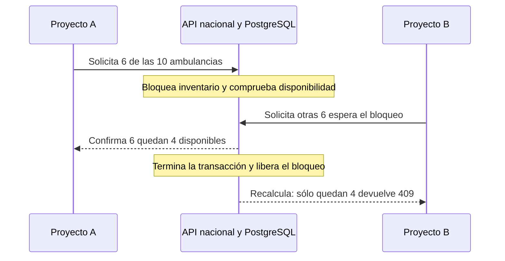

# Explicación del bloqueo de recursos de las ONG

En RescueSync, bloquear recursos significa **reservar una cantidad del inventario
de una ONG para un proyecto**. Si una ONG tiene 10 ambulancias y compromete 6,
quedan 4 disponibles para otras emergencias. La reserva afecta a esa cantidad;
un booleano que marque todo el recurso como bloqueado no representa este caso.

## Cuándo se reservan los recursos

El compromiso ocurre después de la adjudicación del municipio:

1. Las ONG presentan sus ofertas en RescueSync.
2. Al cerrar la convocatoria, Bonita obtiene las ofertas consolidadas y solicita
   a la API nacional la validación de competencias y disponibilidad.
3. El municipio selecciona las ofertas y cantidades adjudicadas.
4. Bonita solicita el compromiso a la API nacional.
5. La API vuelve a validar las condiciones, registra la reserva y confirma la
   transacción. Después, Bonita confirma la adjudicación en la aplicación local.

**Presentar una oferta o validar sus competencias no reserva recursos.** La
disponibilidad consultada puede cambiar antes de solicitar el compromiso.

## Dos mecanismos con duraciones distintas

| Mecanismo | Duración | Función |
| --- | --- | --- |
| Bloqueo de una fila en PostgreSQL | Hasta finalizar la transacción con `commit` o `rollback`. | Coordina operaciones simultáneas sobre el mismo inventario. |
| Compromiso registrado en la base nacional | Hasta que se libera el compromiso de la ONG. | Mantiene reservadas las cantidades mientras la ONG trabaja. |

El bloqueo temporal utiliza `SELECT … FOR UPDATE`. Otra transacción que intente
bloquear o modificar esa misma fila espera a que termine la primera. Las
consultas normales pueden seguir leyendo. Esta protección funciona entre
distintas conexiones y réplicas de la API porque la administra PostgreSQL.
Véase la [documentación de bloqueos de filas](https://www.postgresql.org/docs/16/explicit-locking.html#LOCKING-ROWS).

El compromiso conserva la reserva una vez terminado el bloqueo temporal. La
base no mantiene una transacción abierta durante los días que dura la emergencia.

## Cómo se registra el compromiso

La API debe ejecutar la operación en una única transacción:

1. Verificar la identidad y los permisos del emisor, y reclamar la clave de
   idempotencia para evitar duplicaciones.
2. Crear o recuperar el proyecto, bloquearlo y comprobar que está abierto.
3. Agrupar las cantidades por recurso: si aparece en varios ítems, validar la
   suma de todos ellos.
4. Proteger las habilitaciones y bloquear las filas de inventario involucradas,
   siguiendo el orden estable definido en el modelo nacional.
5. **Después de obtener los bloqueos**, recalcular la disponibilidad en una
   consulta nueva y comprobar cantidades, pertenencia a la ONG, capacidad,
   unidad y habilitaciones vigentes para el riesgo requerido.
6. Registrar los compromisos, sus ítems y el resultado idempotente, y hacer
   `commit`. La respuesta de éxito se entrega después de confirmar.

Si falla cualquier ítem, se hace `rollback` de toda la solicitud, incluso si
incluye varias ONG. No quedan reservas parciales. Stock insuficiente produce
`409 Conflict`.

Comprometer, liberar y editar inventario deben respetar el mismo protocolo de
bloqueo. Se bloquea el proyecto antes de los recursos cuando la operación usa
ambos, y los recursos se ordenan por UUID. No se hacen llamadas HTTP a Bonita
o a RescueSync mientras se mantienen los bloqueos. El orden completo, incluidos
cuentas, ONG y catálogos, está en la sección 5 del
[modelo nacional](./modelo-base-datos-nacional.md#5-restricciones-disponibilidad-y-concurrencia).

## Ejemplo: dos proyectos quieren las mismas ambulancias

Una ONG tiene 10 ambulancias. Los proyectos A y B solicitan 6 cada uno:



La segunda operación vuelve a consultar los compromisos después de esperar.
Con `READ COMMITTED`, esa consulta nueva ve lo confirmado por la primera
transacción. Calcular el stock antes de esperar permitiría decidir con una
cantidad desactualizada. Véase el
[aislamiento de transacciones en PostgreSQL](https://www.postgresql.org/docs/16/transaction-iso.html#XACT-READ-COMMITTED).

## Disponibilidad, liberación y cierre

La disponibilidad se deriva de las reservas activas:

```text
comprometido = suma de cantidades de compromiso_item
              cuyo compromiso tiene estado ACTIVO
disponible = recurso.cantidad_total − comprometido
```

`recurso` conserva el total; `compromiso` identifica el proyecto y la ONG;
`compromiso_item` registra cada recurso y su cantidad reservada. Se usan
`Decimal` y `Numeric(14,3)` para las cantidades.

Cuando una ONG termina, Bonita solicita la liberación. La API bloquea el proyecto,
los recursos y el compromiso, y cambia su estado a `LIBERADO`, conservando los
ítems y la fecha de finalización. Sus cantidades dejan de descontarse. En el
ejemplo, vuelven a estar disponibles las 10 ambulancias si no hay otras reservas.

La liberación afecta únicamente a los compromisos de la ONG que terminó. Las
reservas de otras ONG que siguen trabajando permanecen activas. El proyecto
sólo puede cerrarse cuando no queda ningún compromiso activo.

La edición del inventario también adquiere los bloqueos correspondientes,
recalcula las reservas y exige `nuevo_total >= comprometido`. Así una ONG no
puede reducir el total por debajo de lo que ya tiene asignado.

## Reintentos sin duplicar reservas

Bonita envía una `Idempotency-Key` estable. La API registra la clave por emisor
y tipo de operación, junto con una huella del contenido y el resultado mínimo:

- Misma clave y mismo contenido: devuelve el resultado anterior.
- Misma clave y contenido distinto: devuelve `409 Conflict`.
- Un timeout después del `commit`: se reintenta con la misma clave o se consulta
  el compromiso; no se genera otra clave para repetir un resultado incierto.

Repetir una liberación conserva la primera fecha y no vuelve a liberar cantidades.
El historial permanece disponible para trazabilidad.

## Estado de implementación

Los modelos y la migración inicial se prepararon en T24. El protocolo de stock
y sus servicios transaccionales corresponden a T27, T32 y T33; la integración
con Bonita corresponde a T37.

Las restricciones del esquema protegen cantidades válidas, pertenencia e
historial. Para garantizar que las reservas no superen el total también deben
implementarse el protocolo de escritura y sus pruebas concurrentes sobre
PostgreSQL real. Este documento describe ese comportamiento previsto.

Referencias del proyecto: [modelo nacional](./modelo-base-datos-nacional.md),
[guía de bloqueo de recursos](<./bloqueo de recursos.md>) y
[plan de Entrega 3](./PLAN_IMPLEMENTACION_ENTREGA_3.md).
