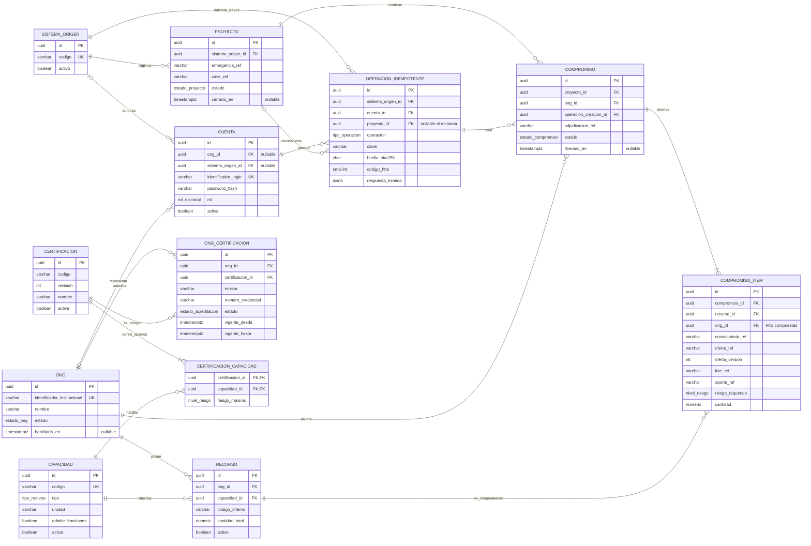

# Modelo de base de datos nacional — Entrega 3

**Estado:** diseño T22 con modelos y migración inicial implementados en T24;
integración de esta implementación pendiente de su PR.
**Fecha del análisis:** 04/10/2026. **Motor propuesto:** PostgreSQL 16, con
SQLAlchemy 2.x síncrono y migraciones Alembic.

La API Cloud necesita una base independiente para cuentas nacionales, ONGs,
certificaciones, inventario y compromisos efectivos. Se propone un modelo de
**12 tablas**, con disponibilidad calculada y trazabilidad de las adjudicaciones.
Las emergencias, los lotes, las ofertas y sus versiones siguen en RescueSync;
Bonita conserva la orquestación y el temporizador.

## 1. Fuentes y criterios de alcance

Se revisaron directamente los PDF y el Excel, además de la documentación y los
contratos ejecutables del checkout hermano:

| Fuente | Qué aporta al diseño |
| --- | --- |
| [Trabajo integrador 2026](<../../RescueSync/docs/Trabajo integrador 2026.pdf>), p. 1 | Consorcios, perfiles de competencia, adjudicación, compromiso posterior y finalización de actividades por ONG. |
| Enunciado, p. 2–3 | Cuentas/JWT, onboarding, certificaciones, ONGs habilitadas, disponibilidad global, locking PostgreSQL y liberación/cierre. |
| Enunciado, p. 3–4 | Ofertas locales, timer en Bonita y consulta iniciada por Bonita antes de invocar la API nacional; alcance de Entrega 3. |
| [Grooming Etapa 2](<../../RescueSync/docs/Grooming Etapa 2.pdf>) y [división de tareas](../../RescueSync/docs/DIVISION_TAREAS_ENTREGA_2.md) | Alcance T1–T21 y separación respecto del sistema nacional. |
| [Modelo local](../../RescueSync/docs/modelo-base-datos-rescuesync.md), [base local](../../RescueSync/docs/base-de-datos.md) y [flujo actual](../../RescueSync/docs/flujo-actual.md) | Organizaciones/usuarios locales, emergencias, convocatorias, snapshots de lotes y versiones inmutables de ofertas. |
| [Autenticación local](../../RescueSync/docs/autenticacion-local.md) | Las cookies, roles y sesiones locales no equivalen a cuentas/JWT nacionales. |
| [Proceso BPM](../../RescueSync/docs/bonita/proceso-bpm.md), [callbacks](../../RescueSync/docs/bonita/callbacks.md), [operación](../../RescueSync/docs/bonita/despliegue-y-operacion.md) y [RescueSync-1.2.bar](../../RescueSync/docs/RescueSync-1.2.bar) | GET del consolidado ya existente, correlación del caso y conectores nacionales pendientes. |
| [Grooming Entrega 3](<./Grooming Entrega 3.xlsx>) | T22 define el modelo; T24 lo migra; T25–T33 implementan el negocio; T34–T37 lo integran; T41 lo verifica. |
| [Plan de implementación](./PLAN_IMPLEMENTACION_ENTREGA_3.md), [bloqueo de recursos](<./bloqueo de recursos.md>) y [AGENTS.md](../AGENTS.md) | UUID nacionales, decimales, roles nacionales, idempotencia, disponibilidad derivada y reglas transaccionales propuestas por el equipo. |

**Requisitos de la cátedra:** los servicios y la separación distribuida indicados
en el enunciado. **Decisiones propuestas del equipo:** las 12 tablas, nombres de
campos, UUID, precisión decimal, estados, claves únicas y protocolo específico
de locks descritos aquí. El enunciado no impone un esquema SQL concreto.

El relevamiento confirma que el esquema local llega a la revisión
`20260929_0007`, aunque el encabezado de `base-de-datos.md` todavía menciona 0006.
El contrato local `backend/app/schemas/bonita.py` conserva IDs enteros y cantidades
serializadas como números. El consolidado aún no incluye UUID nacionales ni
desglose de inventario. El `.bar` 1.2 contiene `solicitarOfertas` hacia ese GET,
pero no conectores nacionales en `Validar Oferta`, `Registrar compromiso`,
`Reservar recursos` o `Liberar Recursos`.

El PDF descriptivo del BPM refleja un recorrido anterior: ubica validación antes
de consultar el consolidado y cierre antes de liberar. Para la integración se
toman el enunciado, el artefacto 1.2 y el plan vigente: obtener consolidado,
validar, adjudicar, comprometer, liberar por ONG y cerrar sin compromisos activos.
Este documento no modifica el proceso ni contratos de Entrega 2.

## 2. Qué persiste en cada sistema

| Sistema | Fuente de verdad | Referencias que intercambia |
| --- | --- | --- |
| PostgreSQL local de RescueSync | Municipios, coordinadores, usuarios/roles locales, emergencias, lotes, convocatorias, ofertas/versiones, consorcios, adjudicaciones, resultados de validación y sincronización. | UUID nacionales de ONG/recurso, proyecto/compromisos confirmados y claves de idempotencia. |
| Bonita | Caso, tareas humanas, timer y orden de ejecución del proceso. | IDs locales, `caseId`, snapshot consolidado, perfiles nacionales y resultados de compromiso/liberación. |
| PostgreSQL nacional | Cuentas nacionales, emisores autorizados, ONGs, acreditaciones, catálogo de capacidades, inventario, proyectos y compromisos adjudicados. | Identificadores externos mínimos para correlacionar operaciones confirmadas. |

La API nacional no tiene tablas `emergencia`, `lote`, `convocatoria`, `oferta`,
`oferta_version`, `consorcio` ni `resultado_validacion`. Recibe el consolidado
transitoriamente, devuelve perfiles y descarta el cuerpo. Tampoco lo almacena en
logs, JSONB, colas o registros de idempotencia. Un ítem comprometido sí conserva
referencias y cantidades efectivamente adjudicadas para justificar su reserva.

No hay claves foráneas entre bases. Un ID externo siempre se interpreta dentro
de su sistema emisor. El backend local adapta las consultas nacionales para el
frontend; la API nacional no consulta directamente PostgreSQL local ni Bonita.

## 3. Diagrama entidad–relación

La imagen [PNG del modelo](./generated/modelo-base-datos-nacional.png) se genera
desde este mismo bloque Mermaid. El diagrama muestra campos principales; las
tablas de la sección 4 completan tipos, nulabilidad, auditoría y restricciones.
Todas las relaciones dibujadas son internas a la base nacional.



`o|` significa cero o uno, `||` exactamente uno, `o{` cero o muchos y `|{` uno
o muchos. Una ONG puede tener varias cuentas, acreditaciones, recursos y
compromisos; una cuenta ONG pertenece a una sola ONG. Las cuentas administrativas
no tienen ONG ni emisor; las de integración tienen un emisor fijo y no una ONG.

## 4. Diccionario de datos propuesto

### Convenciones comunes

- PK `uuid`, generado por la aplicación. La relación
  `certificacion_capacidad` usa PK compuesta. IDs locales siguen siendo `bigint`
  en RescueSync y viajan como referencias externas, sin FK nacional.
- Cantidades `numeric(14,3)` y `Decimal`; rechazar más de tres decimales antes de
  persistir y no redondear silenciosamente. En DTO nacionales se serializan como
  strings, por ejemplo `"5.000"`.
- Instantes `timestamptz`, aplicación y sesión PostgreSQL en UTC.
  Todas las entidades tienen `creado_en`; las mutables, también
  `actualizado_en`. La actualización del timestamp es explícita en el servicio.
- Campos obligatorios `NOT NULL`, salvo los marcados `NULL`.
  Textos identificadores con longitud máxima y `CHECK (btrim(campo) <> '')`.
  FKs históricas `ON DELETE RESTRICT`; bajas mediante estados, sin borrado de
  compromisos, acreditaciones o resultados idempotentes confirmados.
- Estados/roles se representan con enums de Python y PostgreSQL. Las transiciones
  se autorizan en servicios; un enum por sí solo no controla el ciclo de vida.

### 4.1. `sistema_origen` y `cuenta`: identidad y permisos

| Tabla / campo | Tipo | Decisión |
| --- | --- | --- |
| `sistema_origen.id`, `codigo`, `nombre`, `activo` | UUID, varchar(80), varchar(160), boolean | Emisor registrado administrativamente; `codigo` único y estable. Identifica una instalación local, no el usuario ni el Runtime Bonita. |
| `cuenta.id`, `identificador_login` | UUID, varchar(320) | Login normalizado y único, incluso entre cuentas técnicas y humanas. Puede ser correo o nombre técnico. |
| `cuenta.password_hash` | varchar(255) | Hash pwdlib/Argon2; jamás contraseña, JWT ni secreto de firma. |
| `cuenta.rol`, `activa` | enum, boolean | `ADMIN_NACIONAL`, `ONG`, `INTEGRACION`; estado vigente leído en cada petición. |
| `cuenta.ong_id` | UUID FK, NULL | Obligatorio sólo para rol ONG. |
| `cuenta.sistema_origen_id` | UUID FK, NULL | Obligatorio sólo para integración. Varias cuentas técnicas pueden pertenecer al mismo emisor, permitiendo rotación. |

Un `CHECK` exige exactamente una de estas combinaciones:

| Rol | `ong_id` | `sistema_origen_id` |
| --- | --- | --- |
| `ONG` | No nulo | Nulo |
| `INTEGRACION` | Nulo | No nulo |
| `ADMIN_NACIONAL` | Nulo | Nulo |

El onboarding crea ONG pendiente y cuenta ONG en una transacción. No acepta roles
o acreditaciones oficiales aportados por el solicitante. Una ONG con varias
cuentas no necesita una tabla de membresías para este corte: cada cuenta opera
una institución. Los administradores y emisores se aprovisionan por un comando
administrativo seguro, sin credenciales públicas productivas.

El JWT lleva `sub = cuenta.id`; firma, algoritmo permitido, expiración, issuer y
audience se verifican en el servidor. Cargar cuenta, emisor y ONG vigentes para
autorizar. Una cabecera `caseId` o un `sistemaOrigen` recibido no otorgan permisos.
Las cuentas técnicas operan sólo su emisor; un administrador debe seleccionar
explícitamente el emisor del proyecto y queda identificado como autor. No se
necesitan tablas de JWT, sesiones web ni refresh tokens en Entrega 3.

### 4.2. `ong`: institución nacional

| Campo | Tipo | Decisión |
| --- | --- | --- |
| `id`, `nombre` | UUID, varchar(160) | El nombre es descriptivo y no se usa para mapear identidades. |
| `identificador_institucional` | varchar(80), único | Identificador de registro normalizado; el organismo/tipo de registro debe formar parte del valor para evitar colisiones. No se impone CUIT como requisito de la cátedra. |
| `email_contacto`, `telefono_contacto` | varchar(320), varchar(40) NULL | Datos institucionales; teléfono opcional. |
| `estado` | enum | `PENDIENTE`, `HABILITADA`, `SUSPENDIDA`, `BAJA`. Alta pendiente; habilitación sólo administrativa. |
| `habilitada_en`, `habilitada_por_id` | timestamptz NULL, UUID FK a cuenta NULL | Pareja de auditoría de habilitación; obligatoria si está habilitada. El servicio exige autor administrador. |

La habilitación institucional permite participar, pero no acredita todas las
capacidades ni riesgos. Suspender una ONG impide nuevos compromisos; conserva
sus compromisos activos y permite su liberación por el emisor autorizado.
Una baja no libera stock automáticamente.

### 4.3. `capacidad`, `certificacion` y `certificacion_capacidad`: catálogo

| Tabla / campo | Tipo | Decisión |
| --- | --- | --- |
| `capacidad.id`, `codigo`, `nombre` | UUID, varchar(80) único, varchar(160) | Código explícito, por ejemplo `ATENCION_PREHOSPITALARIA` o `ALIMENTACION`. No interpretar descripciones libres. |
| `capacidad.tipo` | enum | `PERSONAL`, `VEHICULO`, `EQUIPAMIENTO`, `SUMINISTRO`. Un aporte mixto local se descompone en recursos concretos. |
| `capacidad.unidad`, `admite_fracciones`, `activa` | varchar(40), boolean, boolean | Unidad canónica por capacidad, por ejemplo `persona`, `vehiculo`, `racion` o `kg`. Códigos y significado estables. |
| `certificacion.id`, `codigo`, `revision`, `nombre`, `activa` | UUID, varchar(80), integer positivo, varchar(160), boolean | Definición versionada. `UNIQUE (codigo, revision)`; una acreditación apunta a una revisión concreta. |
| `certificacion_capacidad.certificacion_id`, `capacidad_id` | UUID FK + UUID FK, PK compuesta | Relación N:M; una certificación puede acreditar varias capacidades. |
| `certificacion_capacidad.riesgo_maximo` | enum | `BAJA`, `MEDIA`, `ALTA`, `CRITICA`, por capacidad; no un nivel global indiferenciado. |

La tabla `capacidad` y la relación N:M detallan el mínimo del plan sin almacenar
listas de capacidades en JSON. La unidad se obtiene por FK desde la capacidad;
no se duplica en cada recurso. Rechazar unidades incompatibles; este corte no
convierte kg a raciones ni inventa equivalencias. Cantidades de personas y
vehículos deben ser enteras; la regla depende de `admite_fracciones` y se valida
en el servicio y mediante trigger al escribir inventario/ítems.

Una revisión de certificación publicada tiene al menos un alcance. Una vez
otorgada, sus alcances son inmutables: un cambio crea una nueva revisión. El
servicio y un trigger impiden alterar/borrar alcances de una revisión usada y
publicar una revisión sin alcances. Cambiar la unidad, tipo o fraccionabilidad de
una capacidad referenciada también exige un código nuevo. Nombre/descripción
pueden corregirse sin cambiar su significado.

### 4.4. `ong_certificacion`: acreditación real y vigencia

| Campo | Tipo | Decisión |
| --- | --- | --- |
| `id`, `ong_id`, `certificacion_id` | UUID, UUID FK, UUID FK | Acreditación otorgada a una ONG para una revisión específica del catálogo. |
| `emisor`, `numero_credencial` | varchar(160), varchar(120) | Autoridad que la otorgó y referencia verificable. `UNIQUE (ong_id, emisor, numero_credencial)`. |
| `vigente_desde`, `vigente_hasta` | timestamptz | `CHECK (vigente_hasta > vigente_desde)`; intervalo `[desde, hasta)`. |
| `estado` | enum | `OTORGADA` o `REVOCADA`; el vencimiento se calcula, sin cron que actualice estados. |
| `registrada_por_id` | UUID FK a cuenta | Administrador nacional que verificó y registró la credencial. |
| `revocada_en`, `revocada_por_id`, `motivo_revocacion` | timestamptz NULL, UUID FK NULL, varchar(255) NULL | Obligatorios al revocar; historial preservado. |

La institución acreditadora real (`emisor`) y el administrador que carga la
acreditación son datos diferentes. La ONG no puede emitir, renovar ni revocar
sus propias acreditaciones. Una renovación genera una fila nueva; no sustituye
fechas del registro anterior. Pueden coexistir credenciales para una capacidad.

El perfil efectivo combina ONG habilitada, catálogo activo y acreditaciones
otorgadas no vencidas. Para cada capacidad toma el máximo riesgo permitido entre
las credenciales vigentes. Orden explícito `BAJA < MEDIA < ALTA < CRITICA`;
no comparar textos alfabéticamente. En este primer corte, una credencial acredita
todos los alcances de su revisión. Un alcance parcial exige una definición
específica; restricciones individuales más complejas quedan para otra revisión
del modelo, sin sobreacreditar al solicitante.

### 4.5. `recurso`: inventario por ONG

| Campo | Tipo | Decisión |
| --- | --- | --- |
| `id`, `ong_id`, `capacidad_id` | UUID, UUID FK, UUID FK | Fila homogénea de inventario nacional, con dueño y unidad/capacidad determinados. |
| `codigo_interno`, `nombre` | varchar(80), varchar(160) | `UNIQUE (ong_id, codigo_interno)`. Permite distinguir conjuntos o sedes de la misma capacidad. |
| `cantidad_total` | numeric(14,3) | `CHECK (cantidad_total >= 0)`; total que la ONG administra. |
| `activo` | boolean | Baja lógica; desactivar requiere no tener compromisos activos. |

No se almacena `cantidad_disponible` ni otro contador de stock comprometido:

```text
comprometido(recurso) = SUM(compromiso_item.cantidad
                           donde compromiso.estado = ACTIVO)
disponible(recurso) = recurso.cantidad_total - comprometido(recurso)
```

Conservar dueño y capacidad inmutables para no reinterpretar historia. Se puede
corregir nombre y total bajo lock; cambiar de institución/capacidad crea otro
recurso. Cantidades totales iguales a cero significan cero stock, no ausencia de catálogo.
Varias filas de una misma capacidad representan conjuntos disjuntos: no registrar
las mismas personas o vehículos en dos filas. No se modelan personas nominadas,
turnos ni activos serializados en este corte.

El registro histórico del compromiso no implica consumo físico. La liberación
deshace la reserva, como pide el enunciado; no repone automáticamente suministros
consumidos ni descuenta total por entrega. El inventario debe reflejar el total
real mediante sus actualizaciones. Si se necesita registrar consumo al liberar,
debe acordarse una operación atómica adicional antes de usarlo como almacén
físico; no atribuir esa semántica al modelo de reservas de Entrega 3.

### 4.6. `proyecto`: correlación y cierre nacional

| Campo | Tipo | Decisión |
| --- | --- | --- |
| `id`, `sistema_origen_id` | UUID, UUID FK | Proyecto nacional perteneciente al emisor autenticado. |
| `emergencia_ref`, `case_ref` | varchar(120), varchar(120) | Referencias opacas externas; IDs locales/Bonita enviados como identificadores, nunca FKs. |
| `estado` | enum | `ABIERTO` o `TERMINADO`. |
| `cerrado_en`, `cerrado_por_id` | timestamptz NULL, UUID FK a cuenta NULL | Obligatorios al terminar y nulos mientras está abierto. |

`UNIQUE (sistema_origen_id, emergencia_ref)` crea un único proyecto por emergencia
del emisor. Se crea al primer compromiso exitoso, no al validar ofertas.
Convocatorias nuevas del mismo caso reutilizan el proyecto abierto. Un `case_ref`
diferente para la misma emergencia produce conflicto y requiere reconciliación,
no un proyecto nuevo. Terminado es terminal; no admitir nuevas reservas.

Una emergencia cerrada sin ninguna adjudicación no necesita proyecto nacional:
el cierre local/Bonita registra ese recorrido. Si T37 requiere cierre nacional
de proyectos sin recursos, deberá agregar explícitamente un alta idempotente de
proyecto; no crearlo como efecto de una validación.

### 4.7. `compromiso` y `compromiso_item`: asignación efectiva

| Tabla / campo | Tipo | Decisión |
| --- | --- | --- |
| `compromiso.id`, `proyecto_id`, `ong_id` | UUID, UUID FK, UUID FK | Compromiso de una ONG dentro de un proyecto. Un consorcio produce compromisos separados por participante. |
| `compromiso.operacion_creacion_id` | UUID FK a operación idempotente | Agrupa los compromisos de varias ONGs creados en una misma transacción. |
| `compromiso.adjudicacion_ref` | varchar(120) | Referencia estable de la adjudicación local confirmada; detalle de la propuesta en sección 6. |
| `compromiso.estado` | enum | `ACTIVO` o `LIBERADO`; no existe compromiso preliminar/reservado durante validación. |
| `compromiso.liberado_en`, `liberado_por_id` | timestamptz NULL, UUID FK a cuenta NULL | Obligatorios al liberar, nulos mientras está activo. |
| `compromiso_item.id`, `compromiso_id`, `recurso_id`, `ong_id` | UUID, UUID FK, UUID FK, UUID | `ong_id` permite dos FKs compuestas que garantizan mismo dueño. |
| `compromiso_item.convocatoria_ref`, `oferta_ref`, `lote_ref`, `aporte_ref` | varchar(120) | Referencias externas mínimas de ronda, oferta, lote y aporte concreto adjudicado. |
| `compromiso_item.oferta_version` | integer | Positiva; identifica la revisión adjudicada, no la actual mutable. |
| `compromiso_item.riesgo_requerido` | enum | Riesgo del aporte/lote adjudicado, conservado para explicar la validación al comprometer. |
| `compromiso_item.cantidad` | numeric(14,3) | `CHECK (cantidad > 0)`; cantidad adjudicada, no total ofrecido. |

`UNIQUE (proyecto_id, adjudicacion_ref, ong_id)` impide repetir la misma asignación
con otra clave de idempotencia, incluso después de liberarla. Una ONG puede tener
varios compromisos en el proyecto por adjudicaciones diferentes. Un compromiso
tiene al menos un ítem y es inmutable salvo su transición de liberación.

`UNIQUE (compromiso_id, aporte_ref, recurso_id)` impide repetir una línea de
desglose. Para el locking y la disponibilidad se suman todos los ítems del mismo
recurso, aunque provengan de ofertas o lotes distintos. El adaptador no puede
distribuir una cantidad dos veces por aparecer en alternativas del consolidado.

Agregar `UNIQUE (id, ong_id)` a `recurso` y `compromiso`, y en el ítem:

```text
FK (recurso_id, ong_id)    -> recurso(id, ong_id)
FK (compromiso_id, ong_id) -> compromiso(id, ong_id)
```

Esa redundancia acotada impide reservar inventario de otra ONG mediante una
asociación errónea. Un trigger de restricción diferido verifica que cada
compromiso tenga ítems al commit. No se copia la descripción de la oferta, la
lista de participantes ni el cuerpo del consolidado.

### 4.8. `operacion_idempotente`: resultado reutilizable

| Campo | Tipo | Decisión |
| --- | --- | --- |
| `id`, `sistema_origen_id`, `cuenta_id` | UUID, UUID FK, UUID FK | Emisor como ámbito estable y cuenta ejecutora como auditoría. |
| `operacion` | enum | `COMPROMETER`, `LIBERAR`, `CERRAR_PROYECTO`. |
| `clave` | varchar(160) | `Idempotency-Key` opaca, sin credenciales. |
| `huella_sha256` | char(64) | Hash de la solicitud canónica, incluyendo método, destino e IDs/cantidades normalizadas. No se guarda el cuerpo. |
| `proyecto_id` | UUID FK, NULL durante el reclamo | Se completa antes de confirmar una operación exitosa. |
| `codigo_http`, `respuesta_minima` | smallint, JSONB | Resultado de éxito estable: IDs, estados y fechas confirmadas, sin ofertas/JWT ni errores internos. |

`UNIQUE (sistema_origen_id, operacion, clave)`. Elegir el emisor y no sólo la cuenta
permite que el conector recupere resultados después de rotar credenciales. Cada
reintento vuelve a autenticar y autorizar a la cuenta actual para ese emisor.
El administrador tampoco puede reutilizar claves de otro emisor sin autorización.

La inserción de reclamo y su resultado se confirman en la misma transacción que
el negocio. Los campos del resultado pueden ser NULL dentro de esa transacción;
un trigger diferido exige resultado/proyecto completos al commit. No se deja una
fila `EN_PROGRESO` durable que haya que expirar. Si falla el negocio, se revierte
también el reclamo. Para recuperar una clave concurrente usar
`INSERT ... ON CONFLICT DO NOTHING` y luego una consulta nueva; no continuar una
sesión invalidada por una violación de unicidad.

Misma clave y huella devuelve código/cuerpo originales; huella diferente es
`409`. La huella incluye el compromiso destino para que una clave de liberación
no pueda aplicarse a otro. Un reintento de creación devuelve su respuesta original
aunque el compromiso ya se haya liberado; un GET obtiene el estado actual.

Normalizar decimales (`5`, `5.0` y `5.000` equivalen), orden de ítems si no es
significativo e identificadores antes del hash. No aplicar idempotencia persistida
a la evaluación transitoria T31. No purgar claves mientras puedan llegar
reintentos del proyecto: borrar resultados elimina la garantía de replay.

## 5. Restricciones, disponibilidad y concurrencia

### Integridad declarativa y reglas transaccionales

| Invariante | Mecanismo propuesto |
| --- | --- |
| Roles/vínculos válidos, cantidades positivas/no negativas, fechas y estados coherentes | `NOT NULL`, enums y `CHECK` de la propia fila. Rechazar valores no finitos de numeric en Pydantic y con un CHECK específico. |
| Identidades, proyectos, adjudicaciones y claves idempotentes únicos | `UNIQUE`, incluyendo normalización del login/identificador institucional. |
| Recurso y compromiso de la misma ONG | FKs compuestas de la sección 4.7. |
| Compromiso no vacío, revisión publicada con alcances, resultado idempotente completo | Triggers de restricción diferidos al commit. |
| Alcances/unidades históricas estables y cantidades discretas válidas | Triggers específicos y servicios; revisiones nuevas ante cambios semánticos. |
| Certificación registrada por administrador; stock suficiente; proyecto sin activos al cerrar | Servicio transaccional con recarga de permisos y locks. |

La desigualdad `total >= SUM(items activos)` depende de otras filas; no es un
`CHECK` de `recurso`. PostgreSQL no garantiza invariantes entre tablas mediante
un CHECK ordinario ([restricciones PostgreSQL 16](https://www.postgresql.org/docs/16/ddl-constraints.html)).
Se garantiza por un protocolo de escritura único en servicios, permisos de base
para que consumidores no escriban directamente y pruebas concurrentes reales.

La disponibilidad global agrupa por capacidad/unidad, conservando dueño y recurso
en el detalle. Agregar primero compromisos activos por recurso y luego unir con
inventario: un JOIN contra acreditaciones N:M puede multiplicar filas y falsear
stock. Usar `EXISTS` para filtrar habilitaciones. Exponer cantidad total,
comprometida y disponible; stock disponible no equivale a habilitación para un
riesgo determinado. No sumar personas con kg ni distintas capacidades.

### Protocolo de locks y aislamiento

Usar `READ COMMITTED` y transacciones cortas. Orden global propuesto:

1. Reclamar la clave idempotente mediante unicidad, si corresponde.
2. Recargar/bloquear en modo compartido el emisor y la cuenta que autorizan la
   escritura; los cambios administrativos de esos permisos toman lock exclusivo.
3. Crear/reutilizar proyecto por su clave única y bloquearlo `FOR UPDATE`.
4. Bloquear las ONGs involucradas en orden de UUID: `FOR SHARE` para comprometer
   o editar inventario; `FOR UPDATE` para cambiar habilitación/acreditaciones.
5. Bloquear recursos `FOR UPDATE`, ordenados por UUID.
6. Bloquear compromisos existentes en orden de UUID cuando se liberen.

Una operación usa sólo los niveles necesarios y nunca adquiere después un nivel
anterior. Editar inventario toma ONG y recurso, sin proyecto; nunca busca bloquear
un proyecto después del recurso. Renovar/revocar acreditaciones toma primero la
ONG, al igual que habilitar/suspender. Así una revocación y un compromiso no
validan contra estados cruzados. Las bajas del catálogo bloquean sus definiciones
y los compromisos toman locks compartidos sobre las definiciones usadas, después
de las ONGs y antes de recursos, siempre en orden de ID. Revisiones ya otorgadas
no se editan. La liberación puede proceder con ONG suspendida o catálogo vencido.

Los locks de fila duran hasta terminar la transacción; el compromiso persistido
mantiene la reserva después. Esta distinción y el orden estable se apoyan en
[bloqueos PostgreSQL 16](https://www.postgresql.org/docs/16/explicit-locking.html).

**Recalcular stock en una consulta posterior a adquirir todos los locks.** Si
una solicitud esperó a otra, necesita ver los ítems que ésta acaba de confirmar.
`READ COMMITTED` obtiene una instantánea nueva por sentencia
([aislamiento PostgreSQL 16](https://www.postgresql.org/docs/16/transaction-iso.html)).
No calcular la suma antes del lock ni dentro de una sentencia iniciada antes de
la espera. Evaluar vigencia con la hora UTC actual obtenida después de los locks,
no con la hora de inicio de una transacción que pudo esperar y cruzar el vencimiento.

### Comprometer, liberar y cerrar

**Comprometer:** normalizar solicitud y agrupar cantidades por recurso; reclamar
clave; crear/bloquear proyecto abierto; cargar permisos/habilitaciones vigentes;
bloquear inventario; recalcular disponibilidad; verificar dueño, unidad, capacidad,
riesgo y cantidades; insertar todos los compromisos/ítems y resultado idempotente.
Un fallo en cualquier participante revierte todo, incluida la creación del
proyecto. Responder éxito sólo después del commit. No realizar HTTP dentro del lock.

**Liberar:** autorizar al emisor del proyecto; reclamar clave; bloquear proyecto,
recursos y compromiso; pasar `ACTIVO -> LIBERADO` y registrar autor/fecha. Los
ítems permanecen. Repetir, incluso con una clave nueva, conserva la primera fecha
y no libera nuevamente. Bonita libera los compromisos de la ONG finalizada; los
de otras ONGs siguen activos. No se revalida competencia para permitir liberar.

**Cerrar:** reclamar clave y bloquear proyecto; comprobar que no hay compromisos
activos; pasar `ABIERTO -> TERMINADO` con autor/fecha. Si hay activos, `409`.
Repetir el cierre conserva la primera fecha. Comprometer también bloquea proyecto,
por lo que no puede insertar una reserva entre esta comprobación y el commit.

Los servicios traducen referencias inexistentes a `404`, autenticación a `401`,
permisos a `403`, conflictos de stock/estado/clave a `409` y entradas inválidas a
`422`. Locks con timeout/deadlock permiten rollback y reintento acotado con la
misma clave; nunca responder con SQL o una traza.

Ejemplo: hay 10 vehículos. Dos proyectos intentan reservar 6 cada uno. La segunda
transacción espera la fila de recurso; después del primer commit recalcula 6
activos, encuentra 4 disponibles y rechaza su reserva completa. Cuando la primera
ONG finaliza, quedan cero comprometidos y 10 disponibles; el historial sigue
registrando la asignación de 6.

### Índices iniciales

- Todos los `UNIQUE` anteriores, PK y claves referenciadas por FKs compuestas.
- `cuenta(ong_id)` y `cuenta(sistema_origen_id)`.
- `ong(estado)`; `ong_certificacion(ong_id, estado, vigente_hasta)`;
  `ong_certificacion(certificacion_id)`.
- `certificacion_capacidad(capacidad_id)` para buscar capacidades acreditadas.
- `recurso(ong_id, activo)` y `recurso(capacidad_id, activo)`.
- `compromiso(proyecto_id, estado)` y `compromiso(ong_id, estado)`;
  `compromiso(operacion_creacion_id)`.
- `compromiso_item(recurso_id, compromiso_id)` además de su unicidad por aporte.
- `operacion_idempotente(proyecto_id)` y `operacion_idempotente(cuenta_id)`.

No crear una vista materializada de stock como autoridad para reservas; puede
quedar desactualizada. Una consulta/vista ordinaria es suficiente para el corte;
optimizar con planes reales antes de duplicar contadores.

## 6. Integración con Entrega 2 y decisiones de contrato

Los mappings y ampliaciones se implementarán en RescueSync, mediante su propio
PR; aquí se documentan para que el esquema nacional pueda consumirse:

| Dato local | Referencia nacional / tratamiento |
| --- | --- |
| `organizacion.id` de tipo ONG | Mapping explícito hacia `ong.id` UUID; persistido localmente, validado al usarlo. No resolver por nombre o ID numérico coincidente. |
| `lote.tipo_necesidad` y unidad | Código de capacidad y riesgo requerido, acordados al publicar. La descripción libre no demuestra competencia. |
| `oferta_item` RECURSO/PERSONAL/MIXTO | Desglose tipado de aportes: ONG participante, `recursoNacionalId`, cantidad y unidad. Mantener un `aporte_ref` estable por línea/version. |
| Oferta conjunta | Cada participante usa su propio inventario y acreditaciones. La líder no presta habilitación a los miembros. |
| Emergencia, convocatoria, oferta/version y lote | Referencias externas acompañadas de `sistemaOrigen` y `caseId`; guardar nacionalmente sólo las asociadas a compromisos reales. |
| Adjudicación local | **Propuesta adicional:** `adjudicacionId` estable por selección confirmada; su valor se guarda como `adjudicacion_ref`. Se necesita para distinguir una adjudicación nueva de una duplicación con otra clave. |
| Sync nacional | Local guarda clave estable, UUID de proyecto/compromisos, estado pendiente/confirmado/desconocido y error seguro. No se agrega esa copia del estado local al inventario nacional. |

`adjudicacionId` y `aporte_ref` no existen todavía en el consolidado de 1.2.
Son decisiones nuevas para acordar en T34/T37 y OpenAPI antes de conectar
consumidores. Una selección se envía completa e inmutable; modificar un
compromiso activo o enviar ampliaciones con la misma adjudicación requiere una
operación nueva diseñada explícitamente, no cambiar cantidades silenciosamente.

El DTO ampliado conserva los campos actuales (`idEmergencia`, `convocatoriaId`,
`numero`, `lotesCubiertos`, `ofertaId`, `ongId`, `version`, `loteId`) y agrega
referencias nacionales. Los decimales de campos nacionales nuevos usan strings;
no cambiar silenciosamente la serialización numérica de campos antiguos.
Un snapshot histórico sin mapping queda pendiente de asociación y no se
adjudica nacionalmente; no se elimina ni se completa por inferencia.

T31 devuelve, por oferta/version/participante/lote/aporte, capacidades habilitadas,
riesgos permitidos, cantidad disponible consultada, fecha y motivos, con perfil
`PRINCIPAL`, `APOYO` o `SIN_HABILITACION`. Es una respuesta calculada, sin tabla
nacional. `APOYO` requiere un lote compatible y nunca autoriza a ejecutar una
tarea crítica con credenciales insuficientes. RescueSync persiste el resultado
localmente; reabrir convocatoria exige nueva evaluación.

Rutas propuestas, todas bajo `/api/v1`, según el plan:

| Servicio | Datos nacionales que utiliza |
| --- | --- |
| `POST /login`, `POST /ongs` | Cuenta, ONG; onboarding atómico. |
| `GET /certificaciones`, `GET /ongs/habilitadas` | Catálogo, alcances y acreditaciones vigentes. |
| `GET/POST /ongs/{id}/recursos`, `PATCH /ongs/{id}/recursos/{recursoId}` | Inventario de la institución autorizada. |
| `GET /recursos/disponibilidad`, `POST /validaciones` | Disponibilidad/perfiles calculados, sin reservar. |
| `POST /compromisos`, `GET /compromisos/{id}` | Proyecto, compromisos, ítems y resultado idempotente. |
| `POST /compromisos/{id}/liberacion`, `POST /proyectos/{id}/cierre` | Transiciones de finalización con idempotencia y control de activos. |

Un timeout puede ocurrir después del commit nacional. Consultar el compromiso o
repetir con la misma clave; no crear otra para un resultado incierto. Confirmar
localmente la adjudicación/ejecución y el cierre después de reconciliar el éxito
nacional. No existe una transacción distribuida entre las tres bases.

## 7. Implementación del esquema y criterios de verificación

El diseño mantiene el mínimo de nueve entidades del plan y añade emisor,
capacidad y alcance de certificación para normalizar permisos, unidades y
perfiles. T24 materializa las 12 tablas mediante modelos SQLAlchemy y la revisión
`20261004_0001`, sin modificar el repositorio local ni desplegar recursos cloud.

### Revisión del diseño antes de implementar

El contraste con el enunciado y Entrega 2 da una confianza técnica alta en la
estructura para este alcance; no equivale a una probabilidad estadística medida.
La revisión conservó las entidades y precisó estas restricciones:

- Certificaciones nuevas empiezan inactivas y se activan con alcances; una
  revisión otorgada conserva al menos un alcance aunque luego se desactive.
- Un reclamo idempotente permite `proyecto_id`, código y resultado nulos sólo
  dentro de la transacción; los triggers consultan la fila final al commit.
  No evalúan una copia antigua del evento INSERT anterior a completar el resultado.
- FKs compuestas adicionales vinculan operación y proyecto al mismo emisor, y
  compromiso y operación al mismo proyecto. La segunda relación es diferida para
  permitir completar el reclamo dentro de la transacción.
- Las bajas históricas, cambios de ítems, renovaciones sobre la misma credencial,
  cambios de alcances otorgados y alteraciones de primeras fechas de liberación
  quedan rechazados por triggers. El resultado idempotente se completa en una
  sola actualización y luego es inmutable.
- Personas/vehículos requieren capacidades discretas. `NaN` y cantidades negativas
  se rechazan en PostgreSQL. `numeric(14,3)` redondea entradas con más decimales:
  el rechazo de esa precisión excesiva se implementará también en los DTO de
  inventario y adjudicación; el tipo SQL por sí solo no lo garantiza.

Los módulos se registran en [app/db/models](../app/db/models/__init__.py).
La [revisión Alembic](../alembic/versions/20261004_0001_esquema_nacional.py)
mantiene un snapshot propio de enums/tablas y usa su
[SQL de integridad versionado](../alembic/versions/20261004_0001_integridad.sql),
sin importar modelos actuales para reconstruir una revisión histórica.
Las [pruebas del esquema](../tests/test_database_models.py) usan schemas
aleatorios, rollback por prueba y PostgreSQL real. El ciclo de migraciones
comprueba también que downgrade elimina funciones y enums y que Alembic no
detecta diferencias de columnas, defaults, FKs o índices. Alembic no compara
automáticamente los cuerpos de triggers: se prueban sus efectos directamente.

T24 no implementa autenticación HTTP ni servicios de validación, compromiso,
liberación o cierre. El esquema permite construirlos; el control agregado de
stock, el cierre sin activos, la autorización del emisor, la vigencia evaluada al
reservar y el orden global de locks siguen siendo responsabilidades de
T25/T27/T31/T32/T33. No atribuir esos comportamientos completos a la sola migración.

Orden sugerido: T24 crea el esquema en una revisión nueva y manualmente revisada;
T25/T26 implementan identidad/onboarding; T27–T30 inventario y consultas;
T31 perfiles; T32/T33 operaciones transaccionales; T34–T37 integran con local/BPM.
Importar todos los modelos en `app/db/models/__init__.py`, usado por Alembic.
Aplicación y migraciones comparten configuración. Migrar antes del despliegue,
con `upgrade()`/`downgrade()` viables y sin `create_all()` productivo.

Verificar al implementar, sobre PostgreSQL real y sesiones independientes:

1. Cuenta inválida/inactiva, JWT expirado o manipulado, rol/vínculo incorrecto y
   ONG/emisor ajenos no acceden. Onboarding duplicado no deja cuenta huérfana.
2. Catálogo N:M, renovación, revocación y vencimiento por capacidad producen
   perfiles explicables; validación no inserta ofertas/proyectos/reservas.
3. Stock decimal, discreto y unidades compatibles; varios alcances no multiplican
   la disponibilidad. Recurso repetido en varios ítems se suma antes de reservar.
4. Dos proyectos disputan stock; multiítem falla sin reservas parciales; edición
   de total concurrente nunca lo baja de compromisos activos.
5. Reintentos simultáneos con la misma clave crean un resultado; clave con otro
   cuerpo da conflicto; adjudicación repetida con clave distinta no se duplica.
6. Revocación/habilitación concurrente respeta locks; credencial que vence durante
   una espera se reevalúa al obtenerlos.
7. Liberar dos veces conserva fecha e historia; liberar una ONG no altera otra;
   una ONG suspendida puede finalizar y liberar por su emisor autorizado.
8. Cierre concurrente con reserva se serializa; proyecto con activos no termina;
   timeout posterior al commit se reconcilia sin duplicaciones.
9. Upgrade/downgrade/upgrade, metadata Alembic sin diferencias y restricciones
   compuestas/diferidas probadas, incluyendo rechazo de escrituras inválidas.

Usar los comandos de calidad de [AGENTS.md](../AGENTS.md) con `APP_ENV=test`
durante las pruebas. Las pruebas de migraciones requieren una base de pruebas
que permita crear sus schemas temporales y no se ejecutan con `APP_ENV=production`.
La integración de T24 requiere PR con `quality` exitoso; el esquema no declara
implementados los endpoints de T25–T41 ni desplegada la API.

## 8. Reproducir el PNG

El archivo [modelo-base-datos-nacional.mmd](./generated/modelo-base-datos-nacional.mmd)
es una copia exacta del único bloque Mermaid de este documento. La imagen se
renderiza desde Mermaid, sin reinterpretar relaciones mediante generación de IA.
Para extraer la fuente desde la raíz del repositorio:

```bash
python - <<'PY'
from pathlib import Path

documento = Path('docs/modelo-base-datos-nacional.md').read_text()
fuente = documento.split('```mermaid\n', 1)[1].split('```', 1)[0]
Path('docs/generated/modelo-base-datos-nacional.mmd').write_text(fuente)
PY
```

Renderizado con Mermaid 11.12.0. Alternativa de regeneración con Mermaid CLI
instalado en un entorno de herramientas independiente (no en dependencias de la
API):

```bash
mmdc -i docs/generated/modelo-base-datos-nacional.mmd \
  -o docs/generated/modelo-base-datos-nacional.png \
  -b white -t default -w 2400 -s 2
```

El comando requiere Chromium disponible para Mermaid CLI. Comprobar que todos
los campos, líneas y cardinalidades sean legibles antes de reemplazar la imagen.
